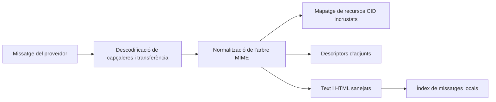

# Correu

## Responsabilitat

Correu integra comptes IMAP/SMTP, indexació local de missatges, carpetes, cerca,
etiquetes, vistes desades, esborranys, adjunts, respostes, consulta de contactes,
redacció amb IA i extracció d'entitats. Les credencials dels proveïdors es
mantenen locals a cada màquina.

El domini amb tipatge estricte `frontend/src/features/mail/` gestiona la
composició de la bústia, els components de correu, els hooks d'etiquetes i
vistes desades i les seves proves. Les rutes utilitzen l'entrada pública
diferida sense carregar immediatament la bústia ni el compositor. Els adaptadors
HTTP compartits conserven els contractes API existents. L'editor de correu
BlockNote i el seu adaptador pertanyen a aquest domini. Configuració consumeix
l'editor mitjançant la seva entrada pública revisada explícitament; no hi ha
implementacions copiades ni façanes de compatibilitat. El trasllat de
responsabilitats no canvia l'enviament,
el desament d'esborranys, la identitat de carpetes, la privacitat ni les
operacions dels proveïdors.

## Visibilitat dels comptes

La barra lateral de correu té un interruptor de visibilitat per compte configurat. Les adreces dels comptes amagats es desen localment a `mail.hiddenAccounts`, normalitzades. La visibilitat es combina amb el selector de comptes abans de carregar els missatges i els comptadors de carpetes; les carpetes, les vistes desades, les categories, les etiquetes i la cerca comparteixen el mateix àmbit. Si tots els comptes estan amagats, la bústia queda buida; canviar la visibilitat tanca el missatge seleccionat. Aquesta preferència de visualització no desactiva la sincronització ni elimina les identitats d’enviament.

## Sincronització

Les integracions de compte descriuen el protocol i les referències OAuth o de
credencials. Una sincronització completa o incremental llegeix els missatges
del proveïdor, normalitza identificadors i contingut MIME i escriu files de
l'índex local. Els processos IMAP IDLE mantenen una connexió per compte elegible
i activen una actualització incremental quan el servidor anuncia canvis.

Els adaptadors de Google i Microsoft exposen els mateixos límits tipats de
missatges, adjunts, esborranys, etiquetes i enviament. Els payloads dinàmics dels
SDK es validen dins de cada adaptador; les úniques excepcions locals de tipatge
són les crides concretes de descobriment de tercers sense tipatge, mai l'API de
servei que consumeix Gnosi.
La renovació OAuth només accepta un token concret no buit abans de desar-lo.
El constructor de credencials i la crida de renovació de Google, sense tipatge,
queden aïllats i documentats dins de l'adaptador; IMAP i SMTP reben tipus de
connexió de la biblioteca estàndard al límit XOAUTH2.

La ingestió per lots utilitza savepoints perquè un missatge malformat no
reverteixi els anteriors. La identitat dels missatges i fils ha de ser estable
entre sincronitzacions. Les metadades d'interfície de cada fil es desen com a
objecte JSON validat dins del límit local de secrets i dades. Les operacions
de lectura, modificació i escriptura comparteixen un bloqueig perquè les
pestanyes concurrents no descartin camps mútuament. Les entrades malformades
de l'arrel o d'un fil es rebutgen sense afectar registres vàlids.
Els noms de carpetes són valors del proveïdor; la interfície tradueix les
carpetes semàntiques conegudes sense canviar els valors desats de comparació.

L'exportador antic de Gmail al vault concreta els payloads de descobriment al
límit del servei, exigeix un directori Mail configurat abans d'accedir a fitxers
i deduplica per identificador de missatge del proveïdor. El text multipartits,
l'HTML, les categories, les etiquetes i la presència d'adjunts conserven la
representació històrica en Markdown i frontmatter; si falta el vault, l'operació
es rebutja sense crear fitxers en altres ubicacions. Cada nota sincronitzada
conserva `database_table_id: mail`, i el frontmatter se serialitza amb
`yaml.dump` en lloc d'escapar cadenes manualment.

## Lectura de converses i previsualització de missatges

Les converses de Gmail utilitzen la bústia `\All` del proveïdor, descoberta a
partir dels indicadors IMAP encara que el nom estigui traduït. Es conserven les
metadades de capçalera anteriors i posteriors al literal del cos IMAP, incloent
la identitat del fil, les dates i les etiquetes d'enviament. Les lectures
conserven el compte i la carpeta perquè els UID IMAP pertanyen a una bústia.
El visor resol el fil des del missatge carregat i desplega i carrega l'element
més recent, incloses les respostes enviades.

Les lectures dels membres d'una conversa utilitzen la mateixa validació de
capçaleres completa i acotada que les bústies agregades. Les connexions o ordres
fallides, o els membres que falten en recuperar-los, produeixen un error que
permet reintentar, en lloc d'un fil buit o parcial presentat com a correcte.

Les lectures del cos dels missatges tenen una connexió IMAP reutilitzable
separada de les llistes de bústies i de les descàrregues d'adjunts. La
reutilització queda vinculada al vault i a la configuració del compte; la
invalidació de credencials tanca ambdues vies i rebutja una connexió obsoleta
que acaba d'autenticar-se després de la invalidació. Un error de transport
invalida només la seva pròpia via. Les lectures del proveïdor acaben amb un
HTTP 503 que permet reintentar al cap de 25 segons, i les mutacions de l'estat
de lectura s'executen en fils de treball. Una actualització encallada de la
marca de lectura no ha de bloquejar el bucle d'esdeveniments del servidor ni
el següent missatge seleccionat.
Les peticions del lector depenen de la identitat del missatge dins del seu
àmbit, i no de la substitució d'objectes o callbacks. El lector conserva com a
màxim setze cossos i una mida estimada de 4 MiB durant cinc minuts després de
recuperar-los; canviar el context de la petició buida aquesta memòria cau.
L’identificador de missatge d’Internet, quan és disponible, diferencia les
versions de selecció i de memòria cau; si canvia, el contingut es torna a carregar
encara que l’UID sigui el mateix.
És una memòria cau de sessió, no una bústia duradora sense connexió.
Els identificadors RFC desats dels missatges van directament a l'emmagatzematge
local del compte; només els UID IMAP decimals entren a la via remota del cos.

Un cos ja carregat pot servir la seva còpia IMAP en una altra carpeta quan el
compte i l'Internet Message-ID original coincideixen. L'UID i la carpeta del
contingut original continuen vinculats a les imatges CID i als adjunts; la
identitat de les accions no es fusiona. Les lectures fallides de cossos i
converses ofereixen reintents explícits traduïts. Les peticions tardanes o
cancel·lades no poden substituir una selecció nova.
Les respostes que contradiuen un compte, una bústia, un proveïdor o un UID
indicats es rebutgen, també amb capçaleres parcialment identificades. Un cos
rebutjat acaba la càrrega i espera un reintent explícit.

Les instantànies de llistes i recomptes i la reutilització d’imatges incrustades
també queden vinculades al vault actiu. La identitat de les imatges conserva
el nom exacte de la bústia.

## Arxiu, llistes completes i cerca

L'Arxiu té una entrada pròpia a la navegació. Tot el correu resol la bústia
`\All` traduïda del servidor en lloc d'INBOX. Els servidors sense una bústia
nativa de tot el correu combinen instantànies només de capçaleres de totes les
bústies seleccionables que no siguin de paperera ni de correu brossa. L'Arxiu
inclou totes les bústies d'arxiu descobertes i les seves subcarpetes. Tant les
llistes natives com les agregades de Tot el correu/Arxiu ordenen totes les
capçaleres coincidents per data abans de paginar, inclosos els missatges
importats en què l'ordre dels UID difereix de la data.
Les transferències de capçaleres utilitzen lots de 200 UID com a màxim; els
lots serialitzats en memòria cau tenen un límit de 256 KiB (com a màxim 32 MiB
de dades de capçaleres a la memòria cau compartida de 128 entrades).
La reutilització exigeix que coincideixin els membres de la bústia, l'àmbit i
UIDVALIDITY. L'absència d'UIDVALIDITY desactiva la memòria cau opcional, seguint
el model d'identitat de bústies de
[l'RFC 9051](https://www.rfc-editor.org/rfc/rfc9051.html#section-2.3.1.1).
Les lectures agregades en fred poden requerir molts intercanvis de capçaleres;
la via del cos continua sent independent. Els noms de carpeta i els UID es
conserven a cada fila, inclosos els UID reutilitzats en carpetes diferents.
Una lectura fallida d'una bústia no pot publicar un resultat complet o buit
que indueixi a error.

El descobriment conserva les bústies personalitzades i les múltiples carpetes
d'arxiu, i omet els contenidors no seleccionables. Sincronitzar una bústia
d'arxiu conserva el tipus de missatge rebut i registra `archived: true`; no classifica
el missatge com a eliminat. Arxivar a Gmail elimina l'etiqueta Safata d'entrada
i conserva les altres etiquetes. Els errors en arxivar remotament continuen
sent errors, sense informar que l'operació ha estat correcta.

Els moviments d’un únic missatge IMAP utilitzen `MOVE` natiu o, després d’una
còpia i una actualització d’indicadors confirmades, la neteja amb `UID EXPUNGE`
(`UIDPLUS` o `IMAP4rev2`). Les ordres fallides continuen sent fallades. Els
servidors sense cap de les dues operacions segures es rebutgen abans de copiar;
moure un missatge no elimina els altres missatges marcats per esborrar.
Vegeu [RFC 9051](https://www.rfc-editor.org/rfc/rfc9051.html#section-6.4.9) per a
la semàntica de la neteja limitada als UID.

Les subcarpetes d’arxiu utilitzen el separador de jerarquia declarat per `LIST`,
incloses les de contenidors d’arxiu no seleccionables. Els espais de noms `NIL`
es mantenen plans, tal com defineix
[RFC 9051](https://www.rfc-editor.org/rfc/rfc9051.html#section-7.3.1).
Les subcarpetes ordinàries hereten el context de l’arxiu encara que es diguin
`Sent`, `Drafts` o `All Mail`. Els atributs de funció especial declarats pel
servidor tenen prioritat; només `\All` designa una bústia nativa de Tot el correu.

Les accions d’arxivar i enviar a la paperera, tant individuals com en seleccions,
transmeten la bústia física de cada fila. Si es rebutja el moviment a la paperera,
es retorna un error que permet reintentar; les metadades desades només canvien
després de l’èxit i registren l’UID de destinació. Una acció individual fallida
conserva la fila i no s’afegeix a l’historial de desfer.

El sentinella de paginació pertany a la llista que realment es desplaça i es
torna a observar quan es completa una pàgina. Un proveïdor que no fa avançar el
cursor exigeix un reintent explícit. Els comptes no disponibles s'exclouen de
la paginació automàtica; els comptes sans poden continuar carregant-se. Els
reintents explícits es dirigeixen als comptes fallits en els seus cursors
fallits i conserven les pàgines ja carregades d'altres comptes.
La cerca s'envia al proveïdor després d'un retard de 250 ms per agrupar els
canvis, de manera que pot retornar coincidències fora de les pàgines carregades
i dins dels cossos. El text de cerca forma part de l'àmbit de la memòria cau de
llistes, i les peticions obsoletes es cancel·len. Els criteris de les vistes
desades continuen filtrant les files carregades; no són regles de correu
entrant ni un motor complet de consultes al servidor.

La [referència d'Apple Mail](../mail-apple-reference.md) recull l'inventari de
la interfície distribuïda, la cobertura actual de Gnosi i el treball pendent
per assolir la paritat.

Els enviaments correctes invaliden les llistes i els recomptes en memòria cau;
la pàgina els actualitza quan el compositor acaba. La previsualització diferida
en passar el cursor carrega tot el text o HTML sanejat sense marcar el missatge
com a llegit. Es manté dins la pantalla i oberta mentre el cursor hi és, i
permet desplaçament vertical, tecles de navegació i Escape. La càrrega només
comença en passar el cursor, amb cancel·lació i reintent. Els marcs HTML
calculen l'alçada a partir del cos i no de la seva pròpia àrea visible, cosa
que evita un creixement repetit de l'alçada.

## Lectura amb el teclat

Les fletxes amunt i avall recorren els grups de missatges en l'ordre visible,
també quan hi ha un correu obert. La fila amb focus s'obre al cap de 500 ms sense
cap altre pas de navegació; les files intermèdies no s'obren ni es marquen com a
llegides. Un clic o la tecla Retorn obren immediatament. El visor existent marca
el correu no llegit després de carregar-lo correctament, conservant la identitat
del compte i la carpeta. Els llegits continuen visibles a la llista per defecte;
els filtres explícits de no llegits i les vistes desades mantenen el comportament
sol·licitat.

El focus segueix la identitat del missatge, no un índex de fila variable. Les
actualitzacions d'estat de lectura en segon pla no redirigeixen la navegació
pendent al correu obert anteriorment. Canviar de compte, carpeta, vista, etiquetes
o cerca cancel·la l'obertura pendent, igual que redactar, obrir un menú, enfocar
un camp, sortir de la finestra o eliminar el missatge de destinació. La selecció
i eliminació en lot amb el teclat continuen disponibles. La previsualització
separada en passar el cursor conserva les seves tecles de desplaçament i no
marca els missatges com a llegits.

## Seguretat del MIME i del contingut

L'HTML es saneja abans de renderitzar-lo. Les imatges CID incrustades es resolen
contra la part MIME correcta i es conserven quan les respostes inclouen contingut
citat. Les imatges remotes i els adjunts continuen sent recursos explícits,
sense donar a l'HTML accés arbitrari a rutes locals.

La frontera d'imatges inline utilitza descriptors MIME tipats i una arrel
`Message` comuna per als arbres de text, related i mixed. Només accepta payloads
descodificats en bytes, normalitza tipus de contingut opcionals i conserva els
URL dels assets si no hi ha Vault actiu o el fitxer no està materialitzat.

Els mateixos contractes `MimeAsset` i `InlineImage` es mantenen entre Gmail,
Microsoft Graph i els remitents SMTP. Els recursos citats es converteixen en
imatges incrustades omplint explícitament tots els camps obligatoris i generant
un Content-ID nou.

## Redacció i enviament

L'editor de blocs crea un esborrany que es converteix en HTML i text adequats
per al correu. El servidor valida la identitat del remitent, els destinataris,
les capçaleres de resposta, el contingut citat, els adjunts i el compte del
proveïdor. Desar un esborrany i enviar-lo són efectes diferents; l'enviament
travessa un límit extern i retorna diagnòstics del proveïdor si falla.

La preparació de l’enviament i les crides al proveïdor s’executen fora del bucle d’esdeveniments del servidor. El servidor limita la resposta a 90 segons i el client limita les capçaleres i tot el cos de resposta a 95 segons. Un resultat incert conserva l’esborrany actiu i els adjunts i demana comprovar Enviats abans de reenviar; no hi ha cap reintent automàtic. El mateix compte no pot iniciar un segon enviament mentre el treballador continuï actiu, encara que la petició hagi caducat. Aquesta exclusió és local al backend en execució, no una deduplicació persistent dels lliuraments. L’acceptació de DATA per SMTP es conserva encara que falli el tancament de la connexió.

Les lectures de l’historial de destinataris s’executen fora del bucle d’esdeveniments i comparteixen una exploració pendent per compte i magatzem. Després de dos segons, els suggeriments retornen els contactes disponibles sense esperar un historial bloquejat. Els camps desplegats CC i CCO precedeixen Assumpte.

## Estat relacional local

La base de dades de correu desa missatges, etiquetes, associacions entre
missatges i etiquetes i vistes desades. Les vistes contenen camps visibles,
filtres tipats, lògica, agrupació, ordenació i accions disponibles com a JSON
dins de files SQLite.
Els esquemes de creació i actualització parcial continuen sent contractes
Pydantic separats: una actualització pot ometre el nom sense debilitar-ne
l'obligatorietat en crear. Les formes HTTP i OpenAPI conserven la
compatibilitat amb els clients 2.x.

## Invariants

- La sincronització és idempotent per a un identificador de missatge del proveïdor.
- Les sincronitzacions IMAP en segon pla conserven les còpies locals Markdown i HTML
  quan un UID no apareix a la cerca del servidor, inclosos els resultats buits i
  els canvis d'espai d'UID. Els moviments remots, la retenció o els resultats
  absents no autoritzen a eliminar l'arxiu local; l'eliminació correspon a les
  accions explícites de correu de l'usuari.
- Un missatge fallit utilitza un savepoint i no interromp el lot del compte.
- Les etiquetes i vistes desades són estat local de l'aplicació, no etiquetes
  del proveïdor, tret que hi hagi un mapatge explícit.
- Les capçaleres de resposta conserven la identitat del fil.
- Les referències CID apunten a la part incrustada correcta després de citar o reenviar.
- Eliminar o moure un missatge del proveïdor exigeix el compte autenticat i una
  destinació de carpeta i missatge validada.
- Els secrets mai no entren a les files de missatges ni a les respostes de configuració del frontend.

## Aspectes que cal verificar

Proveu la descodificació MIME, el sanejament HTML, la renderització CID i les
respostes, els savepoints d'ingestió, les etiquetes, els filtres de vistes, els
esborranys, la resolució d'identitat i un enviament amb proveïdor real o simulat.
Playwright verifica enganxar contingut, redactar i respondre amb contingut citat.
