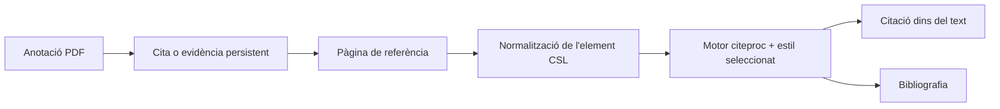

# Lector, referències i citacions

Els dominis de frontend amb tipatge estricte `features/reader/` i
`features/literature/` gestionen les seves pàgines, components locals, estat
i proves. Cadascun exposa una entrada pública diferida, de manera que la
lectura de canals i la cerca bibliogràfica es carreguen independentment.
Els estils de Literatura mantenen l'ordre de cascada existent dins de la
funcionalitat. Els adaptadors compartits de peticions, la integració Zotero,
la configuració de proveïdors i la renderització de citacions no es dupliquen
en aquests dominis.

Les rutes, l'emmagatzematge, l'anàlisi i les fonts del Reader viuen ara a
`backend/domains/reader/`; els repositoris, la cerca, la sincronització i
l'emmagatzematge bibliogràfic, a `backend/domains/literature/`. Els mòduls antics
es mantenen com a façanes compatibles.

L'anàlisi del Reader que depèn del vault, l'accés a resultats, la represa,
la cancel·lació, la recuperació d'articles antics i la generació de pòdcasts
passen per una única comprovació de vault actiu. Si falta context, retornen
una resposta recuperable de servei no disponible abans de crear treballs o
fils; les rutes vàlides del vault i els payloads existents es mantenen estables.
La generació de pòdcasts consumeix directament el generador canònic tipat de
sessions de base de dades i el tanca al bloc `finally` existent; no hi ha cap
conversió de tipus ni fàbrica duplicada de sessions entre l'orquestració del
Reader i la persistència.

Les rutes HTTP, els models canònics i els serveis de revisió sistemàtica estan
tipats estrictament. El recompte PRISMA, les transicions de cribratge,
l'evidència d'accés obert i les exportacions CSV/JSON/Markdown/SVG viuen al
domini pur `review_logic.py`; les funcions històriques continuen com a façanes.

## Portades automàtiques i plantilles de recursos

La creació des d'una font carrega les plantilles de la taula abans de comparar
el tipus Zotero detectat, incloses les etiquetes traduïdes. La plantilla
corresponent aporta contingut i valors inicials; les metadades importades tenen
prioritat, però es conserva una portada existent de la plantilla. Sense
coincidència s'utilitza la plantilla predeterminada. Els registres nous no
hereten els indicadors de plantilla.

La consulta ISBN conserva la portada de l'edició d'Open Library. Les consultes
DOI i web utilitzen la imatge declarada per l'editor mitjançant la consulta
existent d'URL públiques. La portada és opcional i no condiciona les metadades.
Si el PDF pujat no té portada proposada ni de plantilla, el navegador genera
un JPEG acotat de la primera pàgina i el desa a Assets/Covers abans de crear
el recurs. El PDF original continua adjunt. Els errors de generació o pujada
de portada no impedeixen crear el recurs. Les portades en línia són URL
externes; les generades del PDF són fitxers locals. L'enriquiment mostra una
previsualització i no preselecciona substituir una portada existent.

Un únic avís de progrés es manté visible després de tancar el diàleg de cerca.
Indica la preparació, la pujada del PDF, la generació de la portada, el desament
i l’obertura a mesura que comença cada etapa. El mateix avís confirma l’èxit
quan el registre s’ha obert, o mostra un error si la creació falla. Les
importacions per identificador mostren només les etapes aplicables.

## Metadades bibliogràfiques completes

Els camps `Autoría`, `Editors`, `Traductors` i la resta de rols CSL de Recursos fan servir l’editor de tipus `autoria`. La configuració `citation_role` i les metadades internes `_citation_roles` mantenen els rols diferenciats quan es reanomenen els camps. La compleció de l’esquema és additiva i idempotent.

L’esquema Zotero fixat genera `reference_catalog.py` i `referenceCatalog.ts` amb `pipeline/skills/zotero_schema/scripts/build_reference_catalog.py`. Els dos conversors CSL comparteixen el catàleg de camps i dates, conserven any, mes i dia i aprofiten les dades antigues de `Zotero Extras`. La importació acadèmica conserva les metadades bibliogràfiques complementàries durant la deduplicació i la importació.

BibTeX i RIS inclouen els camps i rols compatibles. El camp `gnosimetadata` i l’etiqueta `GN` conserven, en una extensió només bibliogràfica, els dos cognoms, les entitats, els tipus de recurs i els camps que el format no representa. Gnosi els recupera en reimportar, respectant els canvis externs als camps estàndard. Altres programes poden descartar aquesta extensió i no garanteixen recuperar les dades sense equivalència al format. Se n’exclouen les rutes locals i les propietats personals alienes a la bibliografia.

## Responsabilitat

Aquest domini combina la lectura de canals i butlletins amb un gestor de
referències compatible amb Zotero, renderització de citacions CSL, importació
per identificadors i web, lectura PDF/EPUB i anotacions que poden esdevenir
evidència citable.

## Ingestió de referències

Crossref, Open Library, arXiv, PubMed i les metadades HTML tenen normalitzadors
tipats separats a `backend/domains/vault/citations/normalizers/`. Conserven els
payloads canònics de Zotero i el comportament de funció pura, mentre que
`backend/services/lookup_normalizers.py` continua sent la façana compatible.

Les referències entren per DOI, ISBN, arXiv, PMID, BibTeX, RIS, fitxers o URL
web. Els resolutors d'identificadors i Zotero translation-server produeixen
metadades específiques del proveïdor. Els normalitzadors les mapen a l'esquema
configurat, generen una clau de citació estable, dedupliquen candidats i
escriuen un registre al vault.

`backend/services/references_io.py` és el límit tipat i determinista de BibTeX/RIS.
Els seus ajudants petits d'anàlisi, normalització, mapatge de camps i serialització
preserven l'ordre, l'escapat, la resolució del tipus i el contracte públic
d'importació/exportació, sense persistència ni xarxa ocultes.
El deduplicador pur d'importacions utilitza estructures explícites de metadades
i índexs d'identificadors. Manté la prioritat clau de citació, DOI, ISBN i
títol normalitzat; una entrada creada en la mateixa importació s'afegeix
idempotentment als mateixos índexs. Les entrades del catàleg CSL i el mapatge
declaratiu de Zotero a Recursos exposen contractes serialitzables explícits,
preservant els extres arbitraris del proveïdor al límit JSON extern. Els
ressaltats de citacions gestionats per Brain utilitzen mapatge tipat SQLAlchemy;
l'única excepció sense tipatge queda a l'adaptador opcional `pypdfium2`, que
no publica el marcador `py.typed`.

L'orquestració de consulta, que és només de lectura, viu al domini de citacions,
manté la prioritat DOI → arXiv → PMID → ISBN → URL i fa passar les URL aportades
per l'usuari pel descarregador protegit contra SSRF abans de suggerir cap camp.
La taula de Recursos designada es llegeix d'una configuració canònica única;
només els vaults heretats que mai no s'han configurat poden adoptar automàticament
la primera taula amb Citation Key, sota el mateix bloqueig que Configuració.

El servidor de traducció és un servei auxiliar opcional. L'execució nativa pot
prescindir-ne; els resolutors específics d'identificador i les referències
existents continuen funcionant. Les fallades de traducció web retornen errors
que orienten la resolució, en lloc de presentar un registre buit com un èxit.

`citations/pdf_fallback.py` deriva un registre citable de les metadades PDF quan
falla la resolució d'identificadors. `citations/web_capture.py` selecciona i
mapeja resultats Zotero, i `platform/translation_server.py` gestiona el transport HTTP.

## Descobriment acadèmic federat

El connector integrat Recursos gestiona la configuració de repositoris;
`/api/vault/reference-table` continua sent l'única font de veritat de la taula
Recursos de destinació. `/literature` executa cada connector seleccionat
independentment i transmet resultats parcials; els errors de quota o proveïdor
s'associen a aquella font sense descartar els resultats correctes.

`backend/domains/literature/connectors/` gestiona el transport HTTPS acotat,
l'auditoria de peticions, la normalització canònica, OAI-PMH i JSON personalitzat,
els grafs de citacions i els adaptadors per família de proveïdors.
`backend/services/academic_connectors.py` és només una façana de compatibilitat.
El port tipat resol els col·laboradors de la façana en cada crida perquè les proves
i integracions puguin substituir transport, validació, parsers i dispatch sense
duplicar estat mutable.

L’adaptador de Dimensions tracta `dimensions_api_key` com una clau API. Cada cerca
envia primer `{ "key": "..." }` a `https://app.dimensions.ai/api/auth` amb POST,
valida el token retornat i envia la consulta DSL en UTF-8 a `/api/dsl/v2` amb
`Authorization: JWT <token>`. El token s’obté per a cada cerca i no es desa.
Cal disposar d’una subscripció amb accés a l’API de Dimensions habilitat.

El transport POST compartit manté la validació HTTPS, els temps límit, els límits
de mida i els errors segurs de credencials i quota. Rebutja les redireccions per
no reenviar la clau ni el token. L’auditoria registra el mètode HTTP real sense
incloure el cos de la petició ni les capçaleres d’autorització. Els tokens absents
o invàlids i els errors de consulta es comuniquen com a errors del connector.
`backend/tests/test_dimensions_connector.py` verifica el flux i els errors amb
respostes HTTP simulades; la validació real requereix una clau API habilitada.

`AcademicWork` és el contracte canònic dels connectors. Les unions deterministes
utilitzen, per ordre, DOI normalitzat, PMID o PMCID, identificador arXiv sense
versió, ISBN-13 i títol normalitzat més any i cognom del primer autor. Una
coincidència aproximada de títol només és un avís. Les obres fusionades conserven
totes les aparicions a les fonts, ubicacions obertes, recomptes de citacions
per proveïdor, procedència de cada camp i variants en conflicte.

La previsualització és de només lectura. Adjuntar el text complet és una acció
manual separada, disponible només per a una ubicació oberta verificada. La
importació passa l'obra fusionada pel mapatge compartit de Recursos compatible
amb Zotero i repeteix la comprovació d'identitat sota un bloqueig atòmic. Si
ja hi ha un registre de Recursos coincident, l'API el retorna sense duplicar-lo.

L'adaptador d'importació concreta tots els objectes imbricats del proveïdor
—publicació, identificadors, dates, ubicacions d'accés obert i extres Zotero—
en un únic límit de mapatge abans de convertir-los. Els payloads de creadors
només es mantenen intencionadament heterogenis al punt de connexió amb Zotero;
les claus deterministes d'obra, la injecció de claus de citació, la pertinença
als quaderns i la reutilització de duplicats mantenen el comportament existent.

## Revisions de literatura

L'estat de revisió sistemàtica es desa en quatre taules del vault gestionades
idempotentment: `Literature Reviews`, `Literature Activities`,
`Literature Candidates` i `Literature Decisions`, aquesta última només amb
addicions. Les estratègies de cerca, les consultes exactes als proveïdors, els
errors parcials, les operacions d'IA, les decisions de cribratge i les
exportacions continuen sent auditables i sincronitzades amb el vault principal.

El cribratge amb un revisor i el doble cec comparteixen el mateix model de
fases. En mode cec, la decisió d'un revisor s'oculta fins que tots dos l'han
enviada; els conflictes passen a consens explícit. La IA pot proposar consultes
editables, reordenar, cribrar o sintetitzar metadades recuperades, però no pot
excloure candidats ni afirmar evidència més enllà del títol, resum o text
complet efectivament proporcionat.
Tant l'alternativa per coincidència de tokens com el reordenador opcional
d'embeddings locals utilitzen un mateix registre tipat de classificació,
preservant l'ordre per puntuació i posició original entre les implementacions.

Els índexs OAI i l'estat temporal de cerca es poden reconstruir i resideixen
sota `LOCAL_DATA`; protocols, historials, candidats, decisions i artefactes
d'auditoria es mantenen al vault principal. Les credencials de repositori
utilitzen Keychain natiu o l'entorn de desplegament i mai no s'escriuen al
vault ni a l'estat del connector.
Les files OAI filtrades conserven la llista canònica tipada d'obres del
connector sense conversions posteriors. L'OCR PDF opcional i l'anàlisi EPUB
limiten les excepcions de tipatge als imports exactes de `pypdfium2` i
`ebooklib`, paquets que no publiquen `py.typed`; els objectes dinàmics no
surten de l'adaptador de documents.

## Flux de citació

Els valors CSL deriven del frontmatter de referències amb mapatges de camps
explícits. Les llistes de noms, dates, tipus d'element, escapament BibTeX/LaTeX
i metadades `extra` de Zotero requereixen normalització. L'esquema fixat
protegeix els tipus i camps compatibles davant dels canvis del projecte d'origen.

`backend/domains/vault/citations/exporting.py` gestiona la neteja del Markdown,
la resolució del subconjunt de citacions, els marcadors de bibliografia,
l'execució de Pandoc i el paquet de descàrrega. La ruta de compatibilitat
conserva la signatura pública i injecta els ports de fitxers, CSL i processos.

## Lector i anotacions

El lector Zotero inclòs mostra PDF i EPUB. Gnosi gestiona el pont que localitza
fitxers, serveix intervals de bytes segurs, rep anotacions i enllaça l'evidència
seleccionada amb registres del vault. Les anotacions inclouen URI d'origen,
pàgina, tipus, geometria, text, comentari, etiquetes, clau gestionada estable
i marques temporals.

Els endpoints de fitxers validen el confinament i gestionen la hidratació del
núvol. Els identificadors persistents d'anotació impedeixen duplicar una cita
generada cada vegada que es reobre el document.

El processament conserva totes les cites a les notes i en selecciona un
subconjunt per ressaltar al PDF. Una heurística local compara cada cita completa
amb el títol i el cos de la nota, donant preferència a l'evidència principal.
Es ressalta com a màxim el 15% del text d'una pàgina, amb un màxim de dues cites
sense solapaments i de passatges diferents. Són límits, no quotes obligatòries;
les cites llargues o poc adequades continuen a les notes sense ressaltat.
La validació de la geometria de totes les cites és independent d'aquesta
selecció visual. Tornar a sincronitzar elimina només els ressaltats obsolets
gestionats pel recurs; conserva les anotacions manuals i les d'altres recursos.

Les propietats de fitxer obren els adjunts PDF i EPUB al lector intern amb
l’acció compartida d’obertura. Els camins relatius al vault es converteixen en
URL d’actius servits; els enllaços locals i els URL externs de documents utilitzen
la mateixa ruta del lector. Si cap tauler gestiona l’esdeveniment d’obertura,
es navega a la pàgina del lector. Obrir un adjunt no modifica el valor desat de
la propietat. Els actius del lector es compilen amb l’script existent i no
s’inclouen al control de versions.

## Canals i butlletins

Els models del Reader desen fonts, articles, estat de lectura, contingut
complet extret i un compte de butlletins. La ingestió de canals utilitza
savepoints de transacció perquè una entrada malformada no reverteixi tot el
lot. Els extractes i l'extracció de text complet són separats; truncar durant
la ingestió no ha de descartar permanentment contingut d'origen recuperable.

## Navegació del lector i desament a Recursos

La llista manté visibles els articles llegits i no llegits. Les fletxes amunt i
avall mouen el focus entre articles i desplacen la llista per mostrar la fila
seleccionada. Quan el focus es manté en una fila durant 500 ms, el lector obre
l'article i el marca com a llegit. Moure el focus, canviar de font o sortir de la
llista cancel·la l'obertura pendent; un clic obre l'article immediatament. Els
canvis d'estat de lectura conserven l'article seleccionat i la posició de la
llista. El cos es carrega sota demanda, i una resposta tardana d'una selecció
anterior no pot substituir el cos actual.

L'acció manual de marcar com a llegit se substitueix per Afegir a Recursos quan
el connector Recursos està activat. L'acció espera el cos complet de l'article i
comprova `/api/vault/reference-table`; si no hi ha destinació configurada, mostra
un error que indica com resoldre-ho sense crear cap registre. El desament crida
`/api/vault/literature/imports` amb el títol, la data de publicació, el nom de la
font, l'URL original i el text del cos. L'importador existent resol la taula
designada i gestiona la persistència; el lector no introdueix una segona
configuració de taula ni una via separada d'escriptura de registres.

Les notícies utilitzen `newspaper-article`, mapat a `newspaperArticle` de Zotero.
Si no hi ha un identificador bibliogràfic més fort, la deduplicació de notícies
utilitza l'URL HTTP(S) original sense el fragment abans de considerar títol, any
i autor. La clau desada permet reutilitzar el recurs existent en importacions
repetides encara que l'article tingui un altre identificador local al lector.
El botó impedeix desaments simultanis, informa de l'èxit i permet reintentar
després d'un error.

## Invariants

- Les claus de citació són estables tret que l'usuari canviï explícitament dades d'identitat.
- La importació deduplica per identificadors autoritatius i metadades normalitzades.
- La fallada d'una font federada no pot invalidar resultats ja retornats per altres fonts.
- La similitud aproximada no fusiona mai obres acadèmiques automàticament.
- Les mètriques de citacions es mantenen separades per proveïdor i no se sumen mai entre si.
- Els suggeriments d'IA no es converteixen en decisions finals de cribratge sense acció humana.
- Les rutes de fitxers del lector no poden sortir de les arrels permeses.
- La identitat del document i la geometria de pàgina d'una anotació sobreviuen als reinicis.
- Els components interns del lector inclòs es tracten com a codi del projecte
  d'origen; els canvis locals d'integració són explícits i reproduïbles.
- Les contrasenyes de configuracions antigues de butlletins es tracten com a
  secrets encara que un model antic exposi un camp de compatibilitat.

## Aspectes que cal verificar

Executeu proves de claus de citació, PubMed, tipus d'element, estils CSL,
escapament BibTeX, entrada/sortida de referències, anotacions, confinament de
rutes, deduplicació d'importacions i savepoints de canals. Afegiu proves de
normalització de connectors, tokens i marques d'eliminació OAI, SSRF/XML,
errors parcials, cegament de revisions, importacions concurrents i recomptes
PRISMA. La validació al navegador ha d'obrir un document de prova real i
comprovar un cicle de citació o anotació; després ha de fer una cerca progressiva
de literatura, inspeccionar-ne la procedència i importar un resultat deduplicat.

## Processament de fonts completes i temps d’espera

El processament conserva la capacitat de context del model seleccionat i envia les
fonts completes quan hi caben. El límit de context i el temps d’execució són independents.
Les peticions de més de 96.000 bytes UTF-8 disposen de fins a 900 segons per intent i
1.920 segons en total; les fases més petites mantenen 240 segons per petició i 360 en
total. Es mantenen els límits de cinc intents i 120 segons d’espera entre intents.
El llindar només modifica el temps d’espera, mai el contingut ni la fragmentació.

Els errors de temps d’espera desen un missatge útil, traduït al diàleg i a les
notificacions. La lectura dirigida copia els plans desats al nou treball abans de
contactar amb el proveïdor per conservar el progrés si falla un nou intent.
Les crides estructurades respecten el mateix límit de context que la resta de lectures.

## Fitxers del lector PDF

El lector PDF integrat necessita tots els fitxers generats de Zotero a `frontend/public/zotero-reader`. Cal executar `bash scripts/runtime/build-zotero-reader.sh` abans de compilar una còpia nova. Vite comprova els fitxers d’entrada i de sortida, incloent-hi el motor PDF, el worker, el visor i la llengua alternativa. L’empaquetat d’escriptori utilitza el mateix validador. Les actualitzacions només de la interfície també han de copiar aquest directori; si falta el host, l’espera s’esgota abans d’obrir el document. Tant el CI de la interfície com les releases preparen aquests fitxers.

Quan l’evidència d’una cita té l’adreça de la font buida, s’utilitza el document adjunt del recurs. Les adreces locals dels adjunts i les rutes HTTP del vault actiu comparteixen la mateixa pestanya del lector i la identitat de les anotacions. El lector carrega els ressaltats existents de totes dues formes d’URI, elimina duplicats segons l’identificador de la base de dades i desa les anotacions noves amb l’URI canònic de l’adjunt. Les anotacions generades i manuals continuen disponibles sense tornar a processar la font; els documents d’altres vaults i les adreces externes mantenen identitats separades.

## Assignació de camps a les notes generades

Cada font selecciona `assignment_field_ids` independentment de `index_field_ids`. Si la llista no existeix, es conserva el comportament anterior basat en índexs; una llista buida desactiva les assignacions. Les regles admeten `ai`, `source`, `fixed` i `empty`. Només es poden assignar camps editables. Els valors d’IA segueixen esquemes tipats i els valors categòrics han de pertànyer a les opcions existents. La còpia i els valors fixos conserven zero i fals; les regles buides esborren el valor en reprocessar, mentre que eliminar una regla conserva les metadades existents.

El resolutor compartit `backend/domains/llm_wiki/options.py` consulta `config.catalog_ref` del vault actiu abans de les opcions locals, de manera que la configuració i el processament utilitzen els mateixos valors categòrics. Un `agent_id` antic buit selecciona l’agent principal. L’editor espera que les regles de còpia i valor fix siguin completes abans de desar. Les proves de regressió inclouen `backend/tests/test_llm_wiki_field_assignments.py` i `backend/tests/test_llm_wiki_processing_domain_contract.py`.

## Apartats de les fonts i paratext

El processament exclou de les notes les portades, les metadades editorials, les
cites inicials i els pròlegs o prefacis, tret que l'usuari els demani explícitament.
La cobertura registra aquests passatges i es mantenen com a context.

El Brain conserva `Position` (Posició) numèrica i afegeix una relació única `Section` (Apartat) amb una
taula gestionada d'apartats de les fonts. Els encapçalaments originals conserven
la jerarquia, el text i identificadors diferents encara que no estiguin numerats
o repeteixin títol. Cada apartat pertany a una font i un document d'entrada; els
selectors rebutgen apartats d'altres fonts. Els filtres d'igualtat seleccionen
un apartat; els d'inclusió també els seus descendents. Les pàgines i marques de
temps es mantenen a les citacions. L'àudio i el vídeo utilitzen els capítols
originals disponibles; no se n'inventen.

L'actualització de l'esquema preserva les notes i no inicia cap processament.
El reprocessament explícit assigna apartats i marca els desapareguts com a antics,
conservant les relacions històriques. L'aplicació deriva les assignacions dels
segments verificats, també quan reprèn un punt de control revisat.

### Evidència PDF estable i cerca de cites

L’extracció PDF es desa localment amb el SHA-256 de tots els bytes del fitxer,
la versió de l’extractor i una suma de comprovació del text ordenat i els
localitzadors. L’estimació i el processament comparteixen l’extracció: repetir
l’OCR no invalida una lectura desada si el PDF no ha canviat. Les peticions
simultànies comparteixen una sola extracció. Els bytes modificats, les entrades
corruptes, l’OCR fallit i els fitxers que canvien durant l’extracció no poden
reutilitzar ni publicar aquesta memòria cau. L’absència d’OCR en pàgines amb
imatges és un error explícit; les pàgines en blanc són vàlides. Els recursos
natius es tanquen també quan hi ha errors. La memòria cau conserva l’evidència,
però no certifica la precisió de l’OCR.

La geometria de cites indexa els caràcters natius una sola vegada per pàgina i
sincronització. Els índexs no es comparteixen entre fitxers ni sobreviuen a la
sincronització. Es mantenen les comprovacions de la cita sencera, de les lletres
exactes i de l’ambigüitat; només s’elimina la lectura repetida dels caràcters.

Si PDFium retorna un glif desconegut U+FFFE, un segon descodificador PDF el pot
recuperar només si tota la pàgina normalitzada té la mateixa longitud i tots els
altres caràcters coincideixen. El valor no es dedueix de la cita sol·licitada;
qualsevol altra diferència impedeix la recuperació. Es conserven els índexs de
geometria natius originals.

Les subscripcions es desen de manera autoritativa a
`<Vault>/.gnosi/reader_sources.json` (versió 1). Les files SQLite locals en són una
projecció identificada per URL. El primer accés migra les fonts existents si no hi
ha registre; els accessos posteriors recuperen una base local nova després de
moure el Vault o canviar el directori de dades. Els identificadors continuen sent
locals i es conserven els vincles dels articles existents. Els articles, l'estat
de lectura i les credencials del compte de newsletters continuen a SQLite local;
moure el Vault no trasllada aquests registres.

La creació i eliminació de fonts, la importació OPML i els remitents de newsletters
desen el registre atòmicament abans de confirmar la projecció local. Un bloqueig
local serialitza els canvis i torna a llegir el registre. Una llista buida és
autoritativa i una base antiga no pot ressuscitar fonts eliminades. Les metadades
invàlides, de versió desconeguda o no disponibles al núvol produeixen un error
reintentable sense sobreescriure-les. Les URL amb usuari i contrasenya incrustats
s'han de netejar abans de migrar. El bloqueig local no coordina escriptures
simultànies de dispositius diferents; s'aplica la gestió de conflictes del núvol.

Les adreces de newsletters també admeten `newsletter://address@example.test` i es
desen com a `mailto:address@example.test`, també en importar OPML o el registre.
Es rebutgen duplicats entre els dos formats i àlies amb contrasenyes, delimitadors
codificats, controls, camins o paràmetres. La normalització conserva els vincles
dels articles. Les entrades RSS i mailto existents mantenen el comportament;
l’àlies no configura cap compte de correu ni credencials.

### Cobertura del dia complet i articles sense contingut

El pòdcast diari fixa tots els articles publicats durant les 24 hores anteriors,
inclosos els ja llegits, i exclou els datats en el futur. Els reintents conserven
la selecció, el període, l'idioma i el nom del fitxer dins del treball principal
privat, també en captures antigues sense recursos de comportament.

La generació normalitza el cos complet de l'article i després prova el resum del
canal. Els articles sense cap dels dos s'ometen abans de la síntesi. L'estat exposa
`skipped_articles` amb identificadors i títols; el Lector mostra un avís localitzat.
Si cap article és llegible, `podcast_no_readable_articles` conserva l'MP3 anterior.
Els avisos corresponen exclusivament al treball i les seves entrades fixades.

`podcast_briefing.py` divideix els originals complets en parts i lots de fins a
vuit parts. Cada part té com a màxim 10.000 tokens comptats i ha de produir una
nota no buida amb una cita literal de l'original, un resum de fins a 400 caràcters
i una cita de fins a 160. Les entrades absents, sobrants o amb cites incorrectes
fallen abans de desar-se. Els punts de recuperació privats i versionats no
depenen de la memòria opcional de conversa del model.

`podcast_outline.py` classifica conjuntament totes les targetes amb els seus
resums quan la petició cap dins del límit de 80.000 tokens i del context de
l'aplicació, amb un màxim de 32 grups editorials. Les col·leccions més grans fan
servir una jerarquia acotada de fins a 48 targetes i 40.000 tokens per petició,
respectant el context. Els camps obligatoris d'assignació cobreixen cada
identificador opac. El servidor expandeix les fonts, valida particions exactes
sense duplicats i conserva tots els assumptes de cada grup.

El redactor compon l'episodi complet amb totes les notes i grups. Si hi ha
diversos grups, la resposta exigeix un paràgraf per a cada clau opaca i el
servidor els uneix en l'ordre del pla, sense locutar claus ni metadades. Un
paràgraf buit exigeix declarar explícitament que no té contingut editorial;
les revisions de les fonts i del conjunt ho comproven igualment. Els camps
obligatoris eviten perdre silenciosament un grup, però no demostren cobertura
semàntica. Tots els paràgrafs comparteixen un pressupost global sense límits
individuals de paraules. Els dies amb molta
actualitat tenen un objectiu de 1.380 paraules; les col·leccions petites en tenen
menys. El guió complet ha d'estar entre el 90 i el 109% de l'objectiu global abans
de publicar-se. Els recomptes exactes del servidor i els esborranys del model
guien reescriptures automàtiques acotades. Un text de longitud invàlida no es
desa com a narració vàlida, no es retalla ni es substitueix manualment. Les
evidències massa grans passen per resums interns recursius amb un objectiu
orientatiu d'unes 160 paraules, sense perdre les fonts. Es comprova el context
real de cada petició i cada reducció ha de disminuir la mida. El límit de
paraules del guió locutat continua sent estricte. Cada petició es comprova contra
el context actual, també durant les correccions de longitud.

Les correccions de longitud fan servir un estat numèric actual separat, que
substitueix els recomptes i ajustos antics i conserva les objeccions semàntiques.
El servidor aporta el darrer guió rebutjat quan hi cap després de comprimir les
fonts. Si encara no hi cap, la petició següent demana una composició nova amb un
objectiu absolut, sense aplicar ajustos a un text absent. Cada reintent de
validació també rep el recompte, el sentit del canvi i l'objectiu del guió que
acaba de rebutjar. No es publica ni es retalla una narració invàlida i es mantenen
els límits de crides i context.

`podcast_review.py` valida cites exactes del guió i de les evidències abans de
desar objeccions semàntiques. Les omissions identifiquen les evidències; les
distorsions factuals exigeixen una afirmació citada i evidències que la
contradiguin directament. L'absència en un lot no desmenteix una notícia
fonamentada en un altre. Les notes de producció i les repeticions citen el guió
real. Una altra passada del model contrasta les objeccions i només pot conservar
les demostrades sense modificar-les. Les confirmacions es divideixen en lots
sense eliminar-ne les fonts. Les omissions reals no resoltes bloquegen la
publicació.

Totes les notes completes es revisen contra la narració sencera en lots acotats.
La revisió de l'episodi també comprova els assumptes minoritaris i les repeticions.
Fins a tres rondes completes de redacció i revisió corregeixen les objeccions
automàticament. Només la prosa per a l'oient arriba a la síntesi de veu; no es
locuten etiquetes, evidències, avisos d'accés a fonts ni instruccions de producció.
Les fallades, els rebutjos i la cancel·lació conserven l'àudio anterior.

Les revisions de fonts comproven per separat la fidelitat factual i la cobertura
temàtica, amb fins a 16 notes per lot i la llista completa d'assumptes. L'estat dels
fets, les atribucions i l'abast de les xifres tenen una comprovació específica.
Si el proveïdor esgota la sortida, només es divideix recursivament el lot de fonts
o objeccions fallit; la confirmació conserva totes les evidències originals.
Una fallada indivisible bloqueja la publicació. Cada ronda també revisa l'episodi
sencer encara que hi hagi objeccions sobre fonts. Les objeccions actuals conserven
el tipus i les fonts; les antigues i els guions anteriors no s'acumulen en les
instruccions de correcció. Només el darrer guió es proporciona com a context
opcional separat. Es mantenen els límits de model, sortida, temps i cancel·lació.

`podcast-coverage-report`, versió 4, conserva l'esquema, totes les notes, les
assignacions del servidor i el recompte de paraules. La cobertura estructural i
les cites literals no demostren per si soles la correcció semàntica: la prova real
ha de comparar el guió amb tots els temes i matisos i mesurar l'MP3 respecte de
l'objectiu aproximat de deu minuts.

Les operacions internes de planificació, resum, redacció i revisió disposen de
300 segons i 16.384 tokens de sortida, inclòs el raonament, tret que el perfil
fixi un límit explícit. Els contractes actuals acompanyen les captures antigues;
aquestes operacions no fan servir delegació opcional. La planificació, la
redacció i el resum només desactiven el raonament si les metadades del proveïdor
el declaren opcional i no hi ha cap elecció explícita al perfil o client. Les
revisions mantenen el raonament habitual. Es conserven el model, les salvaguardes,
les preferències de sortida, els límits de temps, l'àmbit autoritzat i la
publicació atòmica de l'àudio.

L'historial conserva els treballs principals autoritzats al costat de les crides
recents, de manera que els treballs llargs mantenen el control de represa després
de més de 50 crides internes. Mai no s'exposen pares absents o d'un altre àmbit.
Les metadades exactes de context admeten models absents del registre; els límits
explícits tenen prioritat i els models desconeguts mantenen el valor conservador.
La resta d'operacions documentals conserva les seves proteccions.

Els objectius orientatius dels paràgrafs sumen exactament el pressupost global. Els reintents de validació reben els recomptes actuals de cada paràgraf i una distribució proporcional suggerida, recalculada a partir de la resposta immediatament rebutjada. Es poden redistribuir les paraules; només el límit global i les revisions semàntiques determinen l'acceptació.

### Guies internes de correcció acotades

Quan les objeccions confirmades, totes soles, superen el pressupost de context
del redactor, les operacions de resum acotades produeixen una guia de correcció
obligatòria per a cada objecció. El redactor rep un transport compacte en
columnes amb tots els identificadors, tipus i àmbits de font originals; les
objeccions fonamentades completes i les confirmacions es conserven als punts
de control existents. Això no aprova les objeccions ni la narració. Les
revisions de fidelitat, cobertura i episodi complet contra les fonts originals
continuen condicionant la publicació del guió reescrit. No augmenta cap límit
de context, paraules, crides, temps o rondes semàntiques.

Les guies internes utilitzen un alfabet ASCII imprimible restringit per
l'esquema, sense cometes dobles, barres inverses ni caràcters de control.
Per tant, el límit dinàmic de caràcters coincideix amb el límit de bytes UTF-8
amb doble serialització, com a màxim 160 bytes; el backend també comprova
la mida codificada real. Les sortides invàlides passen per la reparació de
validació acotada existent i no arriben al redactor sense comprovar.
Les fonts originals, les objeccions confirmades completes i la narració final
en català conserven el text Unicode. Aquesta restricció de transport no canvia
les fonts incloses ni aprova l'episodi final: les revisions semàntiques completes
i el pressupost de paraules continuen sent obligatoris abans de locutar o publicar.

L'esquema enviat al proveïdor utilitza una àncora final portable en lloc d'una
asserció anticipada, que Xiaomi rebutja com a petició invàlida. El backend exigeix
independentment ASCII imprimible i exclou cometes dobles, barres inverses i salts
de línia, inclòs el salt final que alguns validadors regex accepten. Es mantenen
l'esquema tancat, els identificadors exactes de les objeccions i el límit real de bytes.

La reparació de guies internes inspecciona tots els valors retornats, en lloc de
limitar-se al primer diagnòstic de l'esquema. L'última crida existent del model
rep exactament tots els identificadors invàlids, les objeccions originals
confirmades, els recomptes reals de caràcters i bytes serialitzats i un objectiu
orientatiu inferior al límit estricte existent. El pedaç no pot afegir claus ni
reescriure guies vàlides. L'aplicació restaura el mapa complet i repeteix les
comprovacions originals d'esquema, alfabet i bytes abans de desar-lo. Si cal,
s'omet l'esborrany intern rebutjat per excés de mida; es mantenen les objeccions
originals i els recomptes, dins del límit de context existent de 40.000 tokens.
No canvien les crides permeses, el termini compartit ni les revisions semàntiques finals.

Si una guia rebutjada conté Unicode invàlid, no té un recompte de bytes UTF-8
vàlid. El text intern s'exclou de la reparació i el recompte es marca com a no
disponible; es conserven l'objecció original confirmada i el nombre de caràcters.
La substitució continua subjecta als mateixos controls d'ASCII imprimible i bytes.

El patró enviat al proveïdor també codifica el mateix límit dinàmic de bytes amb un quantificador acotat. Això fa explícit el límit als serveis que no apliquen de manera fiable el camp separat `maxLength`. Es mantenen el límit de l’esquema, la validació local d’ASCII i bytes i les revisions semàntiques completes.

Les correccions de longitud transporten el mateix flux complet i ordenat de paraules en una sola cadena `token_text`, en lloc d’un element JSON per paraula. L’esquema del proveïdor comprova la cadena i totes les exclusions sense un patró global de recompte; el servidor imposa el mateix interval exacte de paraules locutades abans de la revisió semàntica o la veu. Les respostes fora de l’interval passen per la correcció automàtica acotada existent, amb el recompte mesurat i l’objecte original rebut del model. Es comproven tots els marcadors ordenats, les exclusions explícites i els matisos, i es conserva la lectura dels arrays antics. No es retalla ni se substitueix manualment cap text. Es mantenen les revisions de fidelitat, cobertura i conjunt de l’episodi, i els límits de context, crides i temps. Els temps d’espera reals del transport amb recompte restringit motiven aquesta separació; només una generació automàtica real completada pot acreditar el resultat.
