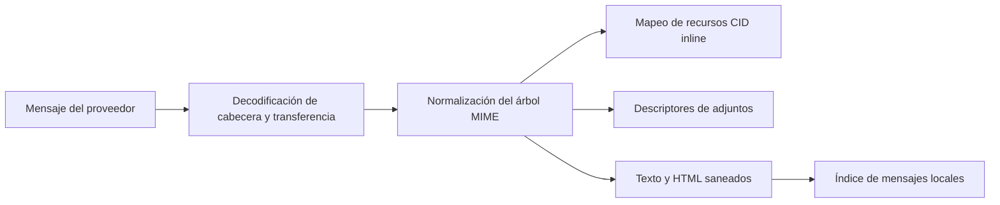

# Correo

## Responsabilidad

Correo integra cuentas IMAP/SMTP, indexación local de mensajes, carpetas, búsqueda, etiquetas, vistas guardadas, borradores, adjuntos, respuestas, búsqueda de contactos, redacción asistida por IA y extracción de entidades. Las credenciales de proveedores permanecen en el almacenamiento local de cada máquina.

El dominio `frontend/src/features/mail/`, estrictamente tipado, gestiona la
composición de la página del buzón, los componentes de correo, los hooks de
etiquetas y vistas guardadas, y sus pruebas. Las rutas de la aplicación consumen
su entrada pública de carga diferida sin cargar anticipadamente el buzón ni el
editor de mensajes. Los adaptadores HTTP compartidos conservan los contratos
API existentes. El editor de correo BlockNote y su adaptador pertenecen a este
dominio. Configuración consume el editor mediante su entrada pública revisada
explícitamente; no hay implementaciones copiadas ni fachadas de compatibilidad. El traslado de
responsabilidades no cambia el envío, el guardado de borradores, la identidad
de carpetas, la privacidad ni las operaciones de proveedores.

## Visibilidad de las cuentas

La barra lateral de correo tiene un interruptor de visibilidad por cuenta configurada. Las direcciones de las cuentas ocultas se guardan localmente en `mail.hiddenAccounts`, normalizadas. La visibilidad se combina con el selector de cuentas antes de cargar los mensajes y los contadores de carpetas; las carpetas, las vistas guardadas, las categorías, las etiquetas y la búsqueda comparten el mismo ámbito. Si todas las cuentas están ocultas, el buzón queda vacío; cambiar la visibilidad cierra el mensaje seleccionado. Esta preferencia de visualización no desactiva la sincronización ni elimina las identidades de envío.

## Sincronización

Las integraciones de cuentas describen el protocolo y las referencias a OAuth o credenciales. Una sincronización completa o incremental lee mensajes del proveedor, normaliza identificadores y contenido MIME, y escribe filas en el índice local. Los workers IMAP IDLE mantienen una conexión por cuenta apta y activan una actualización incremental cuando el servidor anuncia cambios.

Los adaptadores de Google y Microsoft exponen los mismos límites tipados de
mensajes, adjuntos, borradores, etiquetas y envío. Los payloads dinámicos de los
SDK se validan dentro de cada adaptador; las únicas excepciones locales de
tipado son las llamadas concretas de descubrimiento de terceros sin tipado,
nunca la API del servicio que consume Gnosi.
La renovación OAuth solo acepta un token concreto y no vacío antes de guardarlo.
El constructor de credenciales y la llamada de renovación de Google sin tipado
están aislados y documentados dentro del adaptador; IMAP y SMTP reciben tipos
de conexión de la biblioteca estándar en la frontera XOAUTH2.

La ingesta por lotes utiliza savepoints para que un mensaje malformado no revierta los mensajes anteriores. La identidad de mensajes e hilos debe permanecer estable entre sincronizaciones. Los metadatos de interfaz de cada hilo se guardan como un objeto JSON validado dentro del límite local de secretos y datos. Las operaciones de lectura, modificación y escritura comparten un bloqueo para impedir que las pestañas concurrentes descarten silenciosamente los campos de otras; las entradas raíz o de hilo malformadas se rechazan sin afectar a los registros válidos. Los nombres de carpetas son valores del proveedor; la interfaz traduce las carpetas de significado conocido sin cambiar los valores persistidos que se utilizan para compararlas.

El exportador heredado de Gmail al vault restringe los payloads de descubrimiento
en la frontera del servicio, exige un directorio Mail configurado antes de cualquier
acceso al sistema de archivos y deduplica por identificador de mensaje del proveedor.
El texto multipart, el HTML, las categorías, las etiquetas y la presencia de adjuntos
conservan su representación histórica en Markdown y frontmatter; si falta el vault,
la operación se rechaza sin crear archivos en otro lugar. Cada nota sincronizada
conserva `database_table_id: mail`, y el frontmatter se serializa mediante `yaml.dump`
en lugar de construir manualmente cadenas con escapes.

## Lectura de conversaciones y vista previa de mensajes

Las conversaciones de Gmail utilizan el buzón `\All` del proveedor, descubierto
mediante los indicadores IMAP aunque su nombre esté traducido. Se conservan los
metadatos de cabecera anteriores y posteriores al literal del cuerpo IMAP,
incluidos la identidad del hilo, las fechas y las etiquetas de envío. Las
lecturas conservan la cuenta y la carpeta porque los UID IMAP pertenecen a un
buzón. El visor resuelve el hilo desde el mensaje cargado y despliega y carga
su elemento más reciente, incluidas las respuestas enviadas.

Las lecturas de los miembros de una conversación utilizan la misma validación
de cabeceras completa y acotada que los buzones agregados. Las conexiones u
órdenes fallidas, o los miembros que faltan al recuperarlos, producen un error
que permite reintentar, en lugar de un hilo vacío o parcial presentado como
correcto.

Las lecturas del cuerpo de los mensajes tienen una conexión IMAP reutilizable
separada de las listas de buzones y de las descargas de adjuntos. La
reutilización queda vinculada al vault y a la configuración de la cuenta; la
invalidación de credenciales cierra ambas vías y rechaza una conexión obsoleta
que termina de autenticarse después de la invalidación. Un error de transporte
invalida solo su propia vía. Las lecturas del proveedor terminan con un HTTP 503
que permite reintentar al cabo de 25 segundos, y las mutaciones del estado de
lectura se ejecutan en hilos de trabajo. Una actualización atascada de la marca
de lectura no debe bloquear el bucle de eventos del servidor ni el siguiente
mensaje seleccionado.
Las peticiones del lector dependen de la identidad del mensaje dentro de su
ámbito, y no de la sustitución de objetos o callbacks. El lector conserva como
máximo dieciséis cuerpos y un tamaño estimado de 4 MiB durante cinco minutos
después de recuperarlos; cambiar el contexto de la petición vacía esta caché.
El identificador de mensaje de Internet, cuando está disponible, diferencia las
versiones de selección y de caché; si cambia, el contenido se vuelve a cargar
aunque el UID sea el mismo.
Es una caché de sesión, no un buzón duradero sin conexión.
Los identificadores RFC guardados de los mensajes van directamente al
almacenamiento local de la cuenta; solo los UID IMAP decimales entran en la vía
remota del cuerpo.

Un cuerpo ya cargado puede servir su copia IMAP en otra carpeta cuando la
cuenta y el Internet Message-ID original coinciden. El UID y la carpeta del
contenido original siguen vinculados a las imágenes CID y a los adjuntos; la
identidad de las acciones no se fusiona. Las lecturas fallidas de cuerpos y
conversaciones ofrecen reintentos explícitos traducidos. Las peticiones tardías
o canceladas no pueden sustituir una selección nueva.
Se rechazan las respuestas que contradicen una cuenta, un buzón, un proveedor o
un UID indicados, también con cabeceras parcialmente identificadas. Un cuerpo
rechazado termina la carga y espera un reintento explícito.

Las instantáneas de listas y recuentos y la reutilización de imágenes incrustadas
también quedan vinculadas al vault activo. La identidad de las imágenes conserva
el nombre exacto del buzón.

## Archivo, listas completas y búsqueda

Archivo tiene una entrada propia en la navegación. Todo el correo resuelve el
buzón `\All` traducido del servidor en lugar de INBOX. Los servidores sin un
buzón nativo de todo el correo combinan instantáneas solo de cabeceras de todos
los buzones seleccionables que no sean de papelera ni de correo no deseado.
Archivo incluye todos los buzones de archivo descubiertos y sus subcarpetas.
Tanto las listas nativas como las agregadas de Todo el correo/Archivo ordenan
todas las cabeceras coincidentes por fecha antes de paginar, incluidos los
mensajes importados cuyo orden de UID difiere de su fecha.
Las transferencias de cabeceras utilizan lotes de 200 UID como máximo; los
lotes serializados en caché tienen un límite de 256 KiB (como máximo 32 MiB
de datos de cabeceras en la caché compartida de 128 entradas).
La reutilización exige que coincidan los miembros del buzón, el ámbito y
UIDVALIDITY. La ausencia de UIDVALIDITY desactiva la caché opcional, siguiendo
el modelo de identidad de buzones de
[RFC 9051](https://www.rfc-editor.org/rfc/rfc9051.html#section-2.3.1.1).
Las lecturas agregadas en frío pueden requerir muchos intercambios de cabeceras;
la vía del cuerpo sigue siendo independiente. Los nombres de carpeta y los UID
se conservan en cada fila, incluidos los UID reutilizados en carpetas diferentes.
Una lectura fallida de un buzón no puede publicar un resultado completo o vacío
que induzca a error.

El descubrimiento conserva los buzones personalizados y las múltiples carpetas
de archivo, y omite los contenedores no seleccionables. Sincronizar un buzón
de archivo conserva el tipo de mensaje recibido y registra `archived: true`; no clasifica
el mensaje como eliminado. Archivar en Gmail elimina la etiqueta Recibidos y
conserva las demás etiquetas. Los errores al archivar remotamente siguen siendo
errores, sin informar de que la operación ha sido correcta.

Los movimientos de un único mensaje IMAP utilizan `MOVE` nativo o, tras una
copia y una actualización de indicadores confirmadas, la limpieza mediante
`UID EXPUNGE` (`UIDPLUS` o `IMAP4rev2`). Las órdenes fallidas siguen siendo
fallos. Los servidores sin ninguna de las dos operaciones seguras se rechazan
antes de copiar; mover un mensaje no elimina otros mensajes marcados para borrar.
Véase [RFC 9051](https://www.rfc-editor.org/rfc/rfc9051.html#section-6.4.9) para
la semántica de limpieza limitada a los UID.

Las subcarpetas de archivo utilizan el separador de jerarquía declarado por
`LIST`, incluidas las de contenedores de archivo no seleccionables. Los espacios
de nombres `NIL` se mantienen planos, como define
[RFC 9051](https://www.rfc-editor.org/rfc/rfc9051.html#section-7.3.1).
Las subcarpetas ordinarias heredan el contexto del archivo aunque se llamen
`Sent`, `Drafts` o `All Mail`. Los atributos de función especial declarados por
el servidor tienen prioridad; solo `\All` designa un buzón nativo de Todo el correo.

Las acciones de archivar y enviar a la papelera, tanto individuales como en
selecciones, transmiten el buzón físico de cada fila. Si se rechaza el movimiento
a la papelera, se devuelve un error que permite reintentar; los metadatos guardados
solo cambian después del éxito y registran el UID de destino. Una acción individual
fallida conserva la fila y no se añade al historial de deshacer.

El centinela de paginación pertenece a la lista que realmente se desplaza y se
vuelve a observar cuando se completa una página. Un proveedor que no hace
avanzar el cursor exige un reintento explícito. Las cuentas no disponibles se
excluyen de la paginación automática; las cuentas sanas pueden seguir
cargándose. Los reintentos explícitos se dirigen a las cuentas fallidas en sus
cursores fallidos y conservan las páginas ya cargadas de otras cuentas.
La búsqueda se envía al proveedor tras un retardo de 250 ms para agrupar los
cambios, de modo que puede devolver coincidencias fuera de las páginas cargadas
y dentro de los cuerpos. El texto de búsqueda forma parte del ámbito de la
caché de listas, y las peticiones obsoletas se cancelan. Los criterios de las
vistas guardadas siguen filtrando las filas cargadas; no son reglas de correo
entrante ni un motor completo de consultas en el servidor.

La [referencia de Apple Mail](../mail-apple-reference.md) recoge el inventario de
la interfaz distribuida, la cobertura actual de Gnosi y el trabajo pendiente
para alcanzar la paridad.

Los envíos correctos invalidan las listas y los recuentos en caché; la página
actualiza ambos cuando termina el compositor. La vista previa diferida al
pasar el cursor carga todo el texto o HTML saneado sin marcar el mensaje como
leído. Permanece dentro de la pantalla y abierta mientras el cursor está sobre
ella, y permite desplazamiento vertical, teclas de navegación y Escape. La
carga solo comienza al pasar el cursor, con cancelación y reintento. Los marcos
HTML calculan su altura a partir del cuerpo y no de su propia área visible,
evitando el crecimiento repetido de la altura.

## Lectura con el teclado

Las flechas arriba y abajo recorren los grupos de mensajes en el orden visible,
también cuando hay un correo abierto. La fila con foco se abre tras 500 ms sin
otro paso de navegación; las filas intermedias no se abren ni se marcan como
leídas. Un clic o la tecla Intro abren de inmediato. El visor existente marca
el correo no leído después de cargarlo correctamente, conservando la identidad
de la cuenta y la carpeta. Los leídos siguen visibles en la lista predeterminada;
los filtros explícitos de no leídos y las vistas guardadas mantienen el
comportamiento solicitado.

El foco sigue la identidad del mensaje, no un índice de fila variable. Las
actualizaciones del estado de lectura en segundo plano no redirigen la navegación
pendiente al correo abierto anteriormente. Cambiar de cuenta, carpeta, vista,
etiquetas o búsqueda cancela la apertura pendiente, al igual que redactar, abrir
un menú, enfocar un campo, salir de la ventana o eliminar el mensaje de destino.
La selección y eliminación en lote con el teclado siguen disponibles. La vista
previa separada al pasar el cursor conserva sus teclas de desplazamiento y no
marca los mensajes como leídos.

## MIME y seguridad de contenidos

El HTML se sanea antes de renderizarlo. Las imágenes CID inline se resuelven contra la parte MIME correcta y se conservan al incluir contenido citado en las respuestas. Las imágenes remotas y los adjuntos siguen siendo recursos explícitos y no permiten acceder arbitrariamente a rutas locales desde el HTML.

La frontera de imágenes inline utiliza descriptores MIME tipados y una raíz
`Message` común para los árboles de texto, related y mixed. Solo acepta payloads
decodificados en bytes, normaliza tipos de contenido opcionales y conserva las
URL de assets si no hay Vault activo o el archivo no está materializado.
Los mismos contratos `MimeAsset` e `InlineImage` pasan sin cambios por los
servicios de envío de Gmail, Microsoft Graph y SMTP. Los recursos citados se
convierten en imágenes inline completando explícitamente todos los campos
obligatorios y generando un Content-ID nuevo.

## Preparar y enviar

El editor por bloques crea un borrador que se convierte en HTML y texto seguros para correo. La identidad del remitente, los destinatarios, las cabeceras de respuesta, las citas, los adjuntos y la cuenta del proveedor se validan en el servidor. Guardar un borrador y enviarlo son efectos distintos; el envío cruza un límite externo y devuelve diagnósticos del proveedor si falla.

## Estado relacional local

La base de datos de correo almacena mensajes, etiquetas, asociaciones entre mensajes y etiquetas, y vistas guardadas. Las vistas guardadas contienen campos visibles, filtros tipados, lógica, agrupación, ordenación y acciones disponibles como JSON dentro de filas SQLite.
Los esquemas de creación y actualización parcial siguen siendo contratos Pydantic
independientes: una actualización puede omitir el nombre sin debilitar el requisito
de creación. Sus estructuras HTTP y OpenAPI siguen siendo compatibles con los
clientes 2.x.

## Invariantes

- La sincronización es idempotente para cada identificador de mensaje del proveedor.
- Las sincronizaciones IMAP en segundo plano conservan las copias locales Markdown
  y HTML cuando un UID no aparece en la búsqueda del servidor, incluidos los
  resultados vacíos y los cambios de espacio de UID. Los movimientos remotos,
  la retención o los resultados ausentes no autorizan a borrar el archivo local;
  la eliminación corresponde a las acciones explícitas de correo del usuario.
- Un mensaje fallido utiliza un savepoint y no aborta el lote de la cuenta.
- Las etiquetas y vistas guardadas son estado local de la aplicación, no etiquetas
  del proveedor, salvo que exista un mapeo explícito.
- Las cabeceras de respuesta conservan la identidad del hilo.
- Las referencias CID apuntan a la parte en línea correcta después de citar o reenviar.
- Eliminar o mover un mensaje del proveedor requiere la cuenta autenticada y
  un destino de carpeta y mensaje validado.
- Los secretos nunca se incluyen en las filas de mensajes ni en las respuestas de configuración del frontend.

## Enfoque de verificación

Pruebe la decodificación MIME, el saneamiento HTML, el renderizado y las respuestas con CID, los savepoints de ingesta, las etiquetas, los filtros de vistas, los borradores, la resolución de identidad y el envío mediante un proveedor real o un stub. Playwright verifica el pegado, la redacción y el comportamiento de las respuestas con citas.
