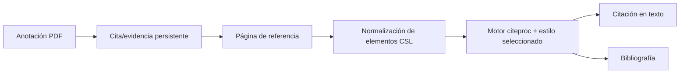

# Lector, referencias y citas

Los dominios del frontend `features/reader/` y `features/literature/`,
estrictamente tipados, gestionan sus respectivas páginas, componentes locales,
estado y pruebas. Cada uno expone una entrada pública de carga diferida para
cargar de forma independiente la lectura de feeds y la búsqueda bibliográfica.
Los estilos de Literatura conservan su orden de cascada dentro de la feature.
Los adaptadores compartidos de peticiones, la integración Zotero, la configuración
de proveedores y el renderizado de citas no se duplican en estos dominios.

Las rutas, el almacenamiento, el análisis y las fuentes del Reader viven ahora
en `backend/domains/reader/`; los repositorios, la búsqueda, la sincronización y
el almacenamiento bibliográfico, en `backend/domains/literature/`. Los módulos
anteriores permanecen como fachadas compatibles.

El análisis del Reader dependiente del vault, el acceso a resultados, la
reanudación, la cancelación, la recuperación de contenido de artículos y la
generación de pódcast pasan por un único control de vault activo. Si falta el
contexto, se devuelve una respuesta recuperable de servicio no disponible antes
de crear trabajos o hilos; las rutas válidas del vault y los payloads existentes
no cambian. La generación de pódcast consume directamente el generador canónico
tipado de sesiones de base de datos y lo cierra en el bloque `finally` existente;
no hay conversiones de tipos ni factorías de sesiones duplicadas entre la
orquestación del Reader y la persistencia.

Las rutas HTTP, los modelos canónicos y los servicios de revisión sistemática
están tipados estrictamente. El recuento PRISMA, las transiciones de cribado, la
evidencia de acceso abierto y las exportaciones CSV/JSON/Markdown/SVG viven en
el dominio puro `review_logic.py`; las funciones históricas siguen como fachadas.

## Portadas automáticas y plantillas de recursos

La creación desde una fuente carga las plantillas de la tabla antes de comparar
el tipo Zotero detectado, incluidas sus etiquetas traducidas. La plantilla
correspondiente aporta contenido y valores iniciales; los metadatos importados
tienen prioridad, pero se conserva una portada existente de la plantilla. Sin
coincidencia se usa la plantilla predeterminada. Los registros nuevos no
heredan los indicadores de plantilla.

La consulta ISBN conserva la portada de la edición de Open Library. Las consultas
DOI y web usan la imagen declarada por el editor mediante la consulta existente
de URL públicas. La portada es opcional y no condiciona los metadatos. Si el PDF
subido no tiene portada propuesta ni de plantilla, el navegador genera un JPEG
acotado de la primera página y lo guarda en Assets/Covers antes de crear el
recurso. El PDF original sigue adjunto. Los errores al generar o subir la portada
no impiden la creación. Las portadas en línea son URL externas; las generadas
del PDF son archivos locales. El enriquecimiento muestra una vista previa y
no preselecciona sustituir una portada existente.

Un único aviso de progreso permanece visible después de cerrar el diálogo de
búsqueda. Indica la preparación, la subida del PDF, la generación de la portada,
el guardado y la apertura al empezar cada etapa. El mismo aviso confirma el
éxito cuando se ha abierto el registro, o muestra un error si falla la creación.
Las importaciones por identificador muestran solo las etapas aplicables.

## Metadatos bibliográficos completos

Los campos `Autoría`, `Editors`, `Traductors` y los demás roles CSL de Recursos usan el editor de tipo `autoria`. La configuración `citation_role` y los metadatos internos `_citation_roles` mantienen los roles diferenciados al renombrar campos. La ampliación del esquema es aditiva e idempotente.

El esquema Zotero fijado genera `reference_catalog.py` y `referenceCatalog.ts` mediante `pipeline/skills/zotero_schema/scripts/build_reference_catalog.py`. Ambos conversores CSL comparten el catálogo de campos y fechas, conservan año, mes y día y aprovechan los valores antiguos de `Zotero Extras`. La importación académica conserva los metadatos complementarios durante la deduplicación y la importación.

BibTeX y RIS incluyen los campos y roles compatibles. El campo `gnosimetadata` y la etiqueta `GN` guardan una extensión exclusivamente bibliográfica para los dos apellidos, las entidades, los tipos de recurso y los campos sin equivalencia en el formato. Gnosi los recupera al reimportar y respeta los cambios externos a los campos estándar. Otros programas pueden descartar la extensión y no garantizan recuperar esos datos. Se excluyen las rutas locales y las propiedades personales ajenas a la bibliografía.

## Responsabilidad

Este dominio combina la lectura de feeds y boletines con un gestor de referencias compatible con Zotero, renderizado de citas CSL, importación por identificador o desde la web, lectura de PDF/EPUB y anotaciones que pueden convertirse en evidencia citable.

## Ingesta de referencias

Crossref, Open Library, arXiv, PubMed y los metadatos HTML tienen normalizadores
tipados separados en `backend/domains/vault/citations/normalizers/`. Conservan
los payloads canónicos de Zotero y el comportamiento de función pura, mientras
`backend/services/lookup_normalizers.py` sigue siendo la fachada compatible.

Las referencias se incorporan mediante DOI, ISBN, arXiv, PMID, BibTeX, RIS, archivos o URL web. Los resolutores de identificadores y el servidor de traducción de Zotero producen metadatos específicos del proveedor. Los normalizadores los mapean al esquema de referencias configurado, generan una clave de cita estable, deduplican candidatos y escriben un registro del vault.

`backend/services/references_io.py` es el límite tipado y determinista de
BibTeX/RIS. Sus pequeños ayudantes de análisis, normalización, mapeo de campos y
serialización preservan el orden, el escape, la resolución del tipo y el contrato
público de importación/exportación, sin persistencia ni red ocultas.
El deduplicador puro de importaciones utiliza estructuras explícitas de metadatos
e índices de identificadores; conserva la prioridad clave de cita, DOI, ISBN y
título normalizado. Las entradas creadas antes en la misma importación se añaden
de forma idempotente a esos mismos índices. Las entradas del catálogo CSL y el
mapeador declarativo de Zotero a Recursos exponen contratos serializables
explícitos y conservan los campos adicionales arbitrarios del proveedor en la
frontera JSON externa. Los resaltados de citas gestionados de Brain utilizan el
mapeo tipado de SQLAlchemy; la única excepción sin tipado está localizada en el
adaptador opcional `pypdfium2`, que no publica un marcador `py.typed`.

La orquestación de consulta, que es solo de lectura, reside en el dominio de citas,
mantiene la prioridad DOI → arXiv → PMID → ISBN → URL y hace pasar las URL del
usuario por el descargador protegido contra SSRF antes de sugerir cualquier campo.
La tabla de Recursos designada se lee desde una única configuración canónica;
solo los vaults heredados que nunca se hayan configurado pueden adoptar
automáticamente la primera tabla con Citation Key, bajo el mismo bloqueo que Ajustes.

Translation-server es un sidecar opcional. La ejecución nativa puede funcionar sin él; los resolutores específicos de identificadores y las referencias existentes siguen funcionando. Los fallos de traducción web devuelven errores que permiten actuar, no un registro vacío presentado como correcto.

`citations/pdf_fallback.py` deriva un registro citable de los metadatos PDF cuando
falla la resolución de identificadores. `citations/web_capture.py` selecciona y
mapea resultados Zotero, y `platform/translation_server.py` gestiona el transporte HTTP.

## Descubrimiento académico federado

El plugin integrado de Recursos gestiona la configuración de repositorios, mientras `/api/vault/reference-table` sigue siendo la única fuente de verdad de la tabla de Recursos de destino. `/literature` ejecuta cada conector seleccionado de forma independiente y transmite resultados parciales; los límites de cuota y los fallos de proveedor se atribuyen a su fuente sin descartar los resultados válidos de las demás.

`backend/domains/literature/connectors/` gestiona el transporte HTTPS acotado,
la auditoría de solicitudes, la normalización canónica, OAI-PMH y JSON
personalizado, los grafos de citas y los adaptadores por familia de proveedores.
`backend/services/academic_connectors.py` es solo una fachada de compatibilidad.
El puerto tipado resuelve los colaboradores de la fachada en cada llamada para
que pruebas e integraciones puedan sustituir transporte, validación, parsers y
dispatch sin duplicar estado mutable.

El adaptador de Dimensions trata `dimensions_api_key` como una clave API. Cada
búsqueda envía primero `{ "key": "..." }` a `https://app.dimensions.ai/api/auth`
mediante POST, valida el token recibido y envía la consulta DSL en UTF-8 a
`/api/dsl/v2` con `Authorization: JWT <token>`. El token se obtiene para cada
búsqueda y no se guarda. Se requiere una suscripción con acceso a la API habilitado.

El transporte POST compartido conserva la validación HTTPS, los tiempos de espera,
los límites de tamaño y los errores seguros de credenciales y cuota. Rechaza las
redirecciones para no reenviar la clave ni el token. La auditoría registra el método
HTTP real sin incluir cuerpos de petición ni cabeceras de autorización. Los tokens
ausentes o inválidos y los errores de consulta se comunican como fallos del conector.
`backend/tests/test_dimensions_connector.py` verifica el flujo y sus errores con
respuestas HTTP simuladas; la validación real requiere una clave API habilitada.

`AcademicWork` es el contrato canónico de los conectores. Las fusiones deterministas utilizan, por orden, DOI normalizado, PMID o PMCID, identificador arXiv sin versión, ISBN-13 y título normalizado junto con el año y el apellido del primer autor. Una coincidencia aproximada de títulos solo genera un aviso. Los trabajos fusionados conservan cada aparición en las fuentes, las ubicaciones de acceso abierto, los recuentos de citas de cada proveedor, la procedencia de campos y las variantes en conflicto.

La vista previa es de solo lectura. Adjuntar el texto completo es una acción manual independiente, ofrecida únicamente para ubicaciones de acceso abierto verificadas. La importación convierte el trabajo fusionado mediante el mapeador compartido de Recursos compatible con Zotero y repite la comprobación de identidad dentro de un bloqueo atómico. Si ya existe un registro de Recursos coincidente, la API lo devuelve en lugar de crear un duplicado.

El adaptador de importación restringe todos los objetos anidados del proveedor
—publicación, identificadores, fechas, ubicaciones de acceso abierto y campos
adicionales de Zotero— mediante un único límite de mapeo antes de convertirlos.
Los payloads de autores siguen siendo intencionalmente heterogéneos solo en el
punto de integración con Zotero; las claves deterministas de trabajos, la inyección
de claves de cita, la pertenencia a cuadernos y la reutilización de duplicados
conservan su comportamiento.

## Revisiones bibliográficas

El estado de las revisiones sistemáticas se almacena en cuatro tablas del vault gestionadas de forma idempotente: `Literature Reviews`, `Literature Activities`, `Literature Candidates` y `Literature Decisions`, esta última solo admite adiciones. Las estrategias de búsqueda, las consultas exactas a proveedores, los errores parciales, las operaciones de IA, las decisiones de cribado y las exportaciones siguen siendo auditables y se sincronizan con el vault principal.

El cribado por un único revisor y el cribado ciego con dos revisores comparten el mismo modelo de fases. En modo ciego, la decisión de cada revisor se oculta hasta que ambos la envían; los conflictos pasan a un consenso explícito. La IA puede proponer consultas editables, reordenar, cribar o sintetizar los metadatos recuperados, pero no puede excluir candidatos ni atribuir evidencia más allá del título, resumen o texto completo realmente proporcionados.
La alternativa basada en solapamiento de tokens y el reordenador opcional con
embeddings locales utilizan la misma estructura tipada de clasificación,
conservando la puntuación y el orden por posición original en ambas implementaciones.

Los índices OAI y el estado temporal de búsqueda pueden reconstruirse y residen bajo `LOCAL_DATA`; los protocolos, historiales, candidatos, decisiones y artefactos de auditoría permanecen en el vault principal. Las credenciales de repositorios utilizan el Keychain nativo o el entorno de despliegue y nunca se escriben en el vault ni en el estado de plugins.
Las filas OAI filtradas conservan la lista canónica tipada de trabajos del conector
sin conversiones de tipos posteriores. El OCR opcional de PDF y el análisis de
EPUB limitan sus únicas excepciones de tipado a los imports concretos de
`pypdfium2` y `ebooklib`, cuyos paquetes no publican `py.typed`; los objetos dinámicos
no salen del adaptador de documentos.

## Ruta de citación

Los valores CSL se derivan del frontmatter de las referencias mediante mapeos de campos explícitos. Las listas de nombres, fechas, tipos de elementos, escapes de BibTeX/LaTeX y metadatos `extra` de Zotero requieren normalización. El esquema fijado protege los tipos y campos compatibles frente a cambios del proyecto de origen.

`backend/domains/vault/citations/exporting.py` gestiona la limpieza del Markdown,
el subconjunto de citas, los marcadores de bibliografía, la ejecución de Pandoc
y el empaquetado de la descarga. La ruta de compatibilidad conserva su firma
pública e inyecta los puertos de archivos, CSL y procesos.

## Lector y anotaciones

El lector Zotero incluido muestra contenido PDF y EPUB. Gnosi posee el puente que localiza archivos, sirve rangos de bytes seguros, recibe anotaciones y enlaza la evidencia seleccionada de nuevo a registros de Vault. Las filas de anotación incluyen URI de origen, página, tipo, geometría, texto, comentario, etiquetas, clave administrada estable y marcas de tiempo.

Los endpoints de archivos validan el confinamiento de rutas y gestionan la hidratación de archivos en la nube. Los identificadores persistentes de anotaciones evitan duplicar una cita generada cada vez que se reabre un documento.

El procesamiento conserva todas las citas en las notas y selecciona un
subconjunto para resaltar en el PDF. Una heurística local compara cada cita
completa con el título y el cuerpo de su nota, dando preferencia a la evidencia
principal. Se resalta como máximo el 15% del texto de cada página, con un máximo
de dos citas sin solapamientos y de pasajes distintos. Son límites, no cuotas
obligatorias; las citas largas o poco adecuadas permanecen en las notas sin
resaltado. La geometría de todas las citas se valida independientemente de
esta selección visual. Sincronizar de nuevo elimina solo los resaltados
obsoletos gestionados por el recurso y conserva las anotaciones manuales y
las de otros recursos.

Las propiedades de archivo abren los adjuntos PDF y EPUB en el lector interno
mediante la acción compartida de apertura. Las rutas relativas al vault se
convierten en URL de activos servidos; los enlaces locales y los URL externos de
documentos usan la misma ruta del lector. Si ningún panel gestiona el evento de
apertura, se navega a la página del lector. Abrir un adjunto no modifica el valor
guardado de la propiedad. Los activos del lector se compilan con el script
existente y no se incluyen en el control de versiones.

## Fuentes y boletines informativos

Los modelos del Reader almacenan fuentes, artículos, estado de lectura, contenido completo extraído y una cuenta de boletines. La ingesta de feeds utiliza savepoints de transacción para que una entrada malformada no revierta todo el lote. Los extractos y la extracción del texto completo son procesos separados; truncar durante la ingesta no debe descartar permanentemente contenido recuperable de la fuente.

## Navegación del lector y guardado en Recursos

La lista mantiene visibles los artículos leídos y no leídos. Las flechas arriba
y abajo mueven el foco entre artículos y desplazan la lista para mostrar la fila
seleccionada. Cuando el foco permanece en una fila durante 500 ms, el lector
abre el artículo y lo marca como leído. Mover el foco, cambiar de fuente o salir
de la lista cancela la apertura pendiente; un clic abre el artículo de inmediato.
Los cambios del estado de lectura conservan el artículo seleccionado y la
posición de la lista. El cuerpo se carga bajo demanda, y una respuesta tardía
de una selección anterior no puede sustituir el cuerpo actual.

La acción manual de marcar como leído se sustituye por Añadir a Recursos cuando
el complemento Recursos está activado. La acción espera el cuerpo completo del
artículo y comprueba `/api/vault/reference-table`; si no hay destino configurado,
muestra un error que indica cómo resolverlo sin crear ningún registro. El
guardado llama a `/api/vault/literature/imports` con el título, la fecha de
publicación, el nombre de la fuente, la URL original y el texto del cuerpo. El
importador existente resuelve la tabla designada y gestiona la persistencia;
el lector no introduce una segunda configuración de tabla ni una vía separada
de escritura de registros.

Las noticias utilizan `newspaper-article`, mapeado a `newspaperArticle` de Zotero.
Si no hay un identificador bibliográfico más fuerte, la deduplicación de noticias
utiliza la URL HTTP(S) original sin el fragmento antes de considerar título, año
y autor. La clave guardada permite reutilizar el recurso existente en
importaciones repetidas aunque el artículo tenga otro identificador local en el
lector. El botón impide guardados simultáneos, informa del éxito y permite
reintentar después de un error.

## Invariantes

- Las claves de citación permanecen estables a menos que el usuario cambie explícitamente los datos de identidad.
- La importación se deduplica mediante identificadores autoritativos y metadatos normalizados.
- Un fallo de fuente federada no puede invalidar los resultados ya devueltos por otras fuentes.
- La similitud difusa nunca fusiona las obras académicas automáticamente.
- Las métricas de citas permanecen separadas por proveedor y nunca se suman.
- Las sugerencias de IA nunca se convierten en decisiones finales de cribado sin una acción humana.
- Las rutas de archivos del lector no pueden escapar de las raíces permitidas.
- La identidad del documento y la geometría de página de una anotación sobreviven a los reinicios.
- El código interno del lector incluido como dependencia se considera código del
  proyecto de origen; las modificaciones locales de integración son explícitas y reproducibles.
- Las contraseñas de configuraciones heredadas de boletines se tratan como secretos
  incluso si un modelo antiguo sigue exponiendo un campo de compatibilidad.

## Enfoque de verificación

Ejecute las pruebas de claves de cita, PubMed, tipos de elementos, estilos CSL, escapes BibTeX, entrada y salida de referencias, anotaciones, confinamiento de rutas, deduplicación de importaciones y savepoints de feeds. Añada pruebas de normalización de conectores, tokens y marcas de eliminación OAI, SSRF/XML, errores parciales, ocultación de decisiones entre revisores, importación concurrente y recuentos PRISMA. La validación en el navegador debe abrir un documento de prueba real y completar un ciclo de creación y lectura de una cita o anotación; después debe realizar una búsqueda bibliográfica progresiva, inspeccionar la procedencia e importar un resultado deduplicado.

## Procesamiento de fuentes completas y tiempos de espera

El procesamiento conserva la capacidad de contexto del modelo seleccionado y envía
las fuentes completas cuando caben. El límite de contexto y el tiempo de ejecución
son independientes. Las peticiones de más de 96.000 bytes UTF-8 disponen de hasta 900
segundos por intento y 1.920 segundos en total; las fases menores mantienen 240
segundos por petición y 360 en total. Se mantienen cinco intentos y un máximo de 120
segundos de espera entre intentos. El umbral solo cambia el tiempo, nunca el contenido
ni la fragmentación.

Los errores de tiempo de espera guardan un mensaje útil, traducido en el diálogo y
las notificaciones. La lectura dirigida copia los planes guardados al nuevo trabajo
antes de contactar con el proveedor, conservando el progreso si vuelve a fallar.
Las llamadas estructuradas respetan el mismo límite de contexto que las demás lecturas.

## Archivos del lector PDF

El lector PDF integrado necesita todos los archivos generados de Zotero en `frontend/public/zotero-reader`. Hay que ejecutar `bash scripts/runtime/build-zotero-reader.sh` antes de compilar una copia nueva. Vite comprueba los archivos de entrada y salida, incluidos el motor PDF, el worker, el visor y el idioma alternativo. El empaquetado de escritorio utiliza el mismo validador. Las actualizaciones solo de la interfaz también deben copiar este directorio; si falta el host, la espera se agota antes de abrir el documento. Tanto el CI de la interfaz como las releases preparan estos archivos.

Cuando la evidencia de una cita tiene vacía la dirección de la fuente, se utiliza el documento adjunto del recurso. Las direcciones locales de los adjuntos y las rutas HTTP del vault activo comparten la misma pestaña del lector y la identidad de las anotaciones. El lector carga los resaltados existentes de ambas formas de URI, elimina duplicados según el identificador de la base de datos y guarda las anotaciones nuevas con el URI canónico del adjunto. Las anotaciones generadas y manuales siguen disponibles sin volver a procesar la fuente; los documentos de otros vaults y las direcciones externas mantienen identidades separadas.

## Asignación de campos a las notas generadas

Cada fuente selecciona `assignment_field_ids` independientemente de `index_field_ids`. Si la lista no existe, se conserva el comportamiento anterior basado en índices; una lista vacía desactiva las asignaciones. Las reglas admiten `ai`, `source`, `fixed` y `empty`. Solo se pueden asignar campos editables. Los valores de IA siguen esquemas tipados y los valores categóricos deben pertenecer a las opciones existentes. La copia y los valores fijos conservan cero y falso; las reglas vacías borran el valor al reprocesar, mientras que eliminar una regla conserva los metadatos existentes.

El resolvedor compartido `backend/domains/llm_wiki/options.py` consulta `config.catalog_ref` del vault activo antes de las opciones locales, de modo que la configuración y el procesamiento utilizan los mismos valores categóricos. Un `agent_id` antiguo vacío selecciona el agente principal. El editor espera que las reglas de copia y valor fijo estén completas antes de guardar. Las pruebas de regresión incluyen `backend/tests/test_llm_wiki_field_assignments.py` y `backend/tests/test_llm_wiki_processing_domain_contract.py`.

## Apartados de las fuentes y paratexto

El procesamiento excluye de las notas las portadas, los metadatos editoriales,
las citas iniciales y los prólogos o prefacios, salvo petición explícita del
usuario. La cobertura registra estos pasajes y se conservan como contexto.

El Brain conserva `Position` (Posición) numérica y añade una relación única `Section` (Apartado) con
una tabla gestionada de apartados de las fuentes. Los encabezados originales
conservan su jerarquía, texto e identidades distintas aunque no estén numerados
o repitan título. Cada apartado pertenece a una fuente y un documento de entrada;
los selectores rechazan apartados de otras fuentes. Los filtros de igualdad
seleccionan un apartado; los de inclusión también sus descendientes. Las páginas
y marcas de tiempo permanecen en las citas. El audio y el vídeo utilizan los
capítulos originales disponibles; no se inventan capítulos.

La actualización del esquema conserva las notas y no inicia procesamiento.
El reprocesamiento explícito asigna apartados y marca los desaparecidos como
antiguos, conservando las relaciones históricas. La aplicación deriva las
asignaciones de segmentos verificados, también al reanudar un punto revisado.

### Evidencia PDF estable y búsqueda de citas

La extracción PDF se guarda localmente con el SHA-256 de todos los bytes del
archivo, la versión del extractor y una suma de comprobación del texto ordenado
y sus localizadores. La estimación y el procesamiento comparten la extracción:
repetir el OCR no invalida la lectura guardada de un PDF sin cambios. Las
solicitudes simultáneas comparten una sola extracción. Los bytes modificados,
las entradas corruptas, el OCR fallido y los archivos que cambian durante la
extracción no pueden reutilizar ni publicar esta caché. La falta de OCR en
páginas con imágenes es un error explícito; las páginas en blanco son válidas.
Los recursos nativos se cierran incluso ante errores. La caché conserva la
evidencia, pero no certifica la precisión del OCR.

La geometría de citas indexa los caracteres nativos una sola vez por página y
sincronización. Los índices no se comparten entre archivos ni sobreviven a la
sincronización. Se mantienen las comprobaciones de la cita completa, las letras
exactas y la ambigüedad; solo se elimina la lectura repetida de los caracteres.

Si PDFium devuelve un glifo desconocido U+FFFE, un segundo decodificador PDF
puede recuperarlo solo si toda la página normalizada tiene la misma longitud y
todos los demás caracteres coinciden. El valor no se deduce de la cita solicitada;
cualquier otra diferencia impide la recuperación. Se conservan los índices de
geometría nativos originales.

Las suscripciones son autoritativas en `<Vault>/.gnosi/reader_sources.json`
(versión 1). SQLite local es una proyección identificada por URL. El primer acceso
migra las fuentes existentes si falta el registro; después permite reconstruir
una base local nueva al mover el Vault o cambiar el directorio de datos. Los
identificadores siguen siendo locales y se conservan los vínculos de artículos
existentes. Artículos, estado de lectura y credenciales de newsletters siguen
en SQLite local; mover el Vault no traslada esos registros.

Crear y eliminar fuentes, importar OPML y crear remitentes de newsletters guarda
el registro atómicamente antes de confirmar SQLite. Un bloqueo local serializa
los cambios y relee el registro. Una lista vacía es autoritativa: una base antigua
no puede resucitar fuentes eliminadas. Los metadatos inválidos, de versión
desconocida o no disponibles en la nube generan un error reintentable sin
sobrescribirlos. Las URL con usuario y contraseña incrustados deben limpiarse
antes de migrar. El bloqueo local no coordina escrituras simultáneas entre
dispositivos; se aplica la gestión de conflictos del proveedor de nube.

Las direcciones de newsletters también admiten `newsletter://address@example.test`
y se guardan como `mailto:address@example.test`, incluso al importar OPML o el
registro. Se rechazan duplicados entre ambos formatos y alias con contraseñas,
delimitadores codificados, controles, rutas o parámetros. Se conservan los vínculos
de artículos. Las entradas RSS y mailto existentes mantienen su comportamiento;
el alias no configura una cuenta de correo ni credenciales.

### Cobertura del día completo y artículos sin contenido

El pódcast diario fija todos los artículos publicados durante las 24 horas
anteriores, incluidos los ya leídos, y excluye los fechados en el futuro. Los
reintentos conservan la selección, el período, el idioma y el nombre del archivo
del trabajo principal privado, también en instantáneas antiguas sin recursos de
comportamiento.

La generación normaliza el cuerpo completo y después prueba el resumen del canal.
Los artículos sin ninguno de los dos se omiten antes de la síntesis. El estado
expone `skipped_articles` con identificadores y títulos; el Lector muestra un
aviso localizado. Si ninguno es legible, `podcast_no_readable_articles` conserva
el MP3 anterior. Los avisos pertenecen al trabajo y a sus entradas fijadas.

`podcast_briefing.py` divide los originales completos en partes y lotes de hasta
ocho partes. Cada parte contiene como máximo 10.000 tokens contados y debe
producir una nota no vacía con una cita literal del original, un resumen de hasta
400 caracteres y una cita de hasta 160. Las entradas ausentes, sobrantes o con
citas incorrectas fallan antes de guardarse. Los puntos de recuperación privados
y versionados no dependen de la memoria opcional de conversación del modelo.

`podcast_outline.py` clasifica conjuntamente todas las tarjetas con sus resúmenes
cuando la petición cabe en el límite de 80.000 tokens y en el contexto de la
aplicación, con hasta 32 grupos editoriales. Las colecciones mayores utilizan una
jerarquía acotada de hasta 48 tarjetas y 40.000 tokens por petición, respetando el
contexto. Los campos obligatorios cubren cada identificador opaco. El servidor
expande las fuentes, valida particiones exactas sin duplicados y conserva todos
los asuntos de cada grupo.

El redactor compone el episodio completo con todas las notas y grupos. Con
varios grupos, la respuesta exige un párrafo por clave opaca; el servidor los
une en el orden del plan sin locutar claves ni metadatos. Un párrafo vacío
exige declarar explícitamente que no tiene contenido editorial, algo que
comprueban igualmente las revisiones de fuentes y del conjunto. Los campos
obligatorios evitan perder un grupo silenciosamente, pero no demuestran su
cobertura semántica. Todos comparten un presupuesto global sin límites de
palabras individuales. Los días con mucha actualidad
tienen un objetivo de 1.380 palabras; las colecciones pequeñas tienen uno menor.
El guion completo debe estar entre el 90 y el 109% del objetivo global antes de
publicarse. Los recuentos exactos del servidor y los borradores del modelo guían
reescrituras automáticas acotadas. El texto de longitud inválida no se guarda
como narración válida, no se recorta ni se sustituye manualmente. Las evidencias
demasiado grandes pasan por resúmenes internos recursivos con un objetivo
orientativo de unas 160 palabras, sin perder sus fuentes. Se comprueba el contexto
real de cada petición y cada reducción debe disminuir el tamaño.
Las respuestas de los resúmenes internos solo contienen `topic` y `narration`.
El servidor asocia todos los identificadores exactos del lote de entrada en cada
nivel de reducción, tras rechazar identificadores inválidos o repetidos.
El modelo no transcribe esa lista, tampoco cuando un único registro recursivo
representa cientos de partes. Los nuevos esquemas y contratos mantienen separados
los puntos de recuperación antiguos con secciones. Esta pertenencia estructural
no aprueba la cobertura temática: las revisiones de fidelidad, cobertura y del
episodio completo contra los originales siguen siendo obligatorias. El límite de
palabras del guion hablado sigue siendo estricto. Cada petición se comprueba
contra el contexto actual, también durante las correcciones de longitud.

Las correcciones de longitud usan un estado numérico actual separado, que
sustituye los recuentos y ajustes antiguos y conserva las objeciones semánticas.
El servidor aporta el último guion rechazado si cabe después de comprimir las
fuentes. Si aún no cabe, la siguiente petición solicita una composición nueva
con un objetivo absoluto, sin aplicar ajustes a un texto ausente. Cada reintento
de validación recibe también el recuento, el sentido del cambio y el objetivo
del guion recién rechazado. No se publica ni se recorta una narración inválida
y se mantienen los límites de llamadas y contexto.

Cuando un borrador estructurado es demasiado corto, la reducción del contexto reserva la composición exacta más reciente y las indicaciones medidas para ampliarla. Sigue resumiendo las evidencias hasta que ambas caben juntas, conservando todos los temas y las objeciones semánticas. La ampliación no utiliza el modo sin evidencias reservado para acortar. Si ninguna reducción adicional permite ajustar el contexto, la generación falla explícitamente en vez de descartar el texto corto y empezar de nuevo. Pueden necesitarse más resúmenes internos ordinarios; no aumentan los intentos de redacción ni los límites de tiempo, contexto o palabras finales.

`podcast_review.py` valida citas exactas del guion y de las evidencias antes de
guardar objeciones semánticas. Las omisiones identifican evidencias; las
distorsiones factuales requieren una afirmación citada y evidencias que la
contradigan directamente. La ausencia en un lote no desmiente una noticia
fundamentada en otro. Las notas de producción y las repeticiones citan el guion
real. Otra pasada del modelo contrasta las objeciones y solo puede conservar las
demostradas sin modificarlas. Las confirmaciones se dividen en lotes sin eliminar
sus fuentes. Las omisiones reales sin resolver bloquean la publicación.

Todas las notas completas se revisan frente a la narración entera en lotes
acotados. La revisión del episodio comprueba también los asuntos minoritarios y
las repeticiones. Hasta tres rondas completas de redacción y revisión corrigen
las objeciones automáticamente. Solo la prosa para el oyente llega a la síntesis
de voz: no se locutan etiquetas, evidencias, avisos de acceso ni instrucciones de
producción. Los fallos, rechazos y cancelaciones conservan el audio anterior.

Las revisiones de fuentes comprueban por separado la fidelidad factual y la
cobertura temática, con hasta 16 notas por lote y la lista completa de asuntos.
El estado de los hechos, las atribuciones y el alcance de las cifras tienen una
comprobación específica. Si el proveedor agota la salida, solo se divide de forma
recursiva el lote fallido de fuentes u objeciones; la confirmación conserva todas
las evidencias originales. Un fallo indivisible bloquea la publicación. Cada
ronda revisa también el episodio completo aunque queden objeciones sobre fuentes.
Las objeciones actuales conservan el tipo y las fuentes; las antiguas y los
guiones previos no se acumulan en las instrucciones de corrección. Solo el último
guion se ofrece como contexto opcional separado. Se mantienen los límites de
modelo, salida, tiempo y cancelación.

`podcast-coverage-report`, versión 4, conserva el esquema, todas las notas, las
asignaciones del servidor y el recuento de palabras. La cobertura estructural y
las citas literales no prueban por sí solas la corrección semántica: la prueba
real debe comparar el guion con todos los temas y matices y medir el MP3 respecto
al objetivo aproximado de diez minutos.

Un episodio válido según el esquema pero fuera del intervalo global de palabras vuelve
inmediatamente al coordinador de longitud existente, con tres intentos. No consume la
llamada de reparación genérica dentro del mismo plazo ya parcialmente gastado. Cada fase
existente conserva su plazo de 300 segundos y las dos llamadas de formato; el
coordinador conserva la composición rechazada exacta, los recuentos medidos y todos los
temas. El JSON malformado mantiene la reparación ordinaria acotada. Tras el último
intento, el error público del presupuesto de palabras no cambia.

Las operaciones internas de planificación, resumen, redacción y revisión tienen
300 segundos y 16.384 tokens de salida, incluido el razonamiento, salvo un límite
explícito del perfil. Los contratos actuales acompañan las instantáneas antiguas;
estas operaciones no utilizan delegación opcional. La planificación, redacción y
resumen solo desactivan el razonamiento si los metadatos del proveedor lo declaran
opcional y no existe una elección explícita en el perfil o cliente. Las revisiones
mantienen el razonamiento habitual. Se conservan el modelo, las salvaguardas,
preferencias de salida, límites de tiempo, ámbito autorizado y publicación atómica.

El historial conserva los trabajos principales autorizados junto con las llamadas
recientes, manteniendo su control de reanudación tras más de 50 llamadas internas.
Nunca expone padres ausentes o de otro ámbito. Los metadatos exactos de contexto
admiten modelos ausentes del registro; los límites explícitos tienen prioridad y
los modelos desconocidos conservan el valor prudente. Las demás operaciones
documentales mantienen sus protecciones.

Los objetivos orientativos de los párrafos suman exactamente el presupuesto global. Los reintentos de validación reciben los recuentos actuales por párrafo y una distribución proporcional sugerida, recalculada a partir de la respuesta inmediatamente rechazada. Las palabras pueden redistribuirse; solo el límite global y las revisiones semánticas determinan la aceptación.

### Guías internas de corrección acotadas

Si las objeciones confirmadas por sí solas superan el presupuesto de contexto
del redactor, las operaciones de resumen acotadas producen una guía de corrección
obligatoria por objeción. El redactor recibe un transporte compacto por columnas
con todos los identificadores, tipos y ámbitos de fuente originales; las
objeciones fundamentadas completas y las confirmaciones permanecen en los puntos
de control existentes. Esto no aprueba las objeciones ni la narración. Las
revisiones de fidelidad, cobertura y episodio completo frente a las fuentes
originales siguen condicionando la publicación del guion reescrito. No aumenta
ningún límite de contexto, palabras, llamadas, tiempo o rondas semánticas.

Las guías internas utilizan un alfabeto ASCII imprimible restringido por el
esquema, sin comillas dobles, barras inversas ni caracteres de control.
Por tanto, el límite dinámico de caracteres coincide con el de bytes UTF-8
con doble serialización, como máximo 160 bytes; el backend también comprueba
el tamaño codificado real. Las salidas inválidas utilizan la reparación de
validación acotada existente y no llegan al redactor sin comprobar.
Las fuentes originales, las objeciones confirmadas completas y la narración
final en catalán conservan el texto Unicode. Esta restricción de transporte
no cambia las fuentes incluidas ni aprueba el episodio final: las revisiones
semánticas completas y el presupuesto de palabras siguen siendo obligatorios
antes de generar voz o publicar.

El esquema enviado al proveedor utiliza un ancla final portable en lugar de una
aserción anticipada, que Xiaomi rechaza como petición inválida. El backend exige
independientemente ASCII imprimible y excluye comillas dobles, barras inversas y
saltos de línea, incluido el salto final que algunos validadores regex aceptan.
Se mantienen el esquema cerrado, los identificadores exactos de las objeciones
y el límite real de bytes.

La reparación de guías internas inspecciona todos los valores devueltos en lugar
de limitarse al primer diagnóstico del esquema. La última llamada existente del
modelo recibe exactamente todos los identificadores inválidos, los hallazgos
originales confirmados, los recuentos reales de caracteres y bytes serializados
y un objetivo orientativo inferior al límite estricto existente. El parche no
puede añadir claves ni reescribir guías válidas. La aplicación restaura el mapa
completo y repite las comprobaciones originales de esquema, alfabeto y bytes
antes de guardarlo. Si es necesario, se omite el borrador interno rechazado por
su tamaño; se conservan los hallazgos originales y los recuentos, dentro del
límite de contexto existente de 40.000 tokens. No cambian las llamadas permitidas,
el plazo compartido ni las revisiones semánticas finales.

Si una guía rechazada contiene Unicode inválido, no tiene un recuento válido de
bytes UTF-8. Su texto interno se excluye de la reparación y el recuento se marca
como no disponible; se conservan el hallazgo original confirmado y el número de
caracteres. La sustitución sigue sujeta a los mismos controles de ASCII imprimible y bytes.

El patrón enviado al proveedor también codifica el mismo límite dinámico de bytes con un cuantificador acotado. Así el límite queda explícito en los servicios que no aplican de forma fiable el campo separado `maxLength`. Se mantienen el límite del esquema, la validación local de ASCII y bytes y las revisiones semánticas completas.

Las correcciones de longitud transportan el mismo flujo completo y ordenado de palabras en una sola cadena `token_text`, en lugar de un elemento JSON por palabra. El esquema del proveedor comprueba la cadena y todas las exclusiones sin un patrón global de recuento; el servidor impone el mismo intervalo exacto de palabras locutadas antes de la revisión semántica o la voz. Las respuestas fuera del intervalo pasan por la corrección automática acotada existente, con el recuento medido y el objeto original recibido del modelo. Se comprueban todos los marcadores ordenados, las exclusiones explícitas y los matices, y se conserva la lectura de los arrays antiguos. No se recorta ni se sustituye manualmente ningún texto. Se mantienen las revisiones de fidelidad, cobertura y conjunto del episodio, y los límites de contexto, llamadas y tiempo. Los tiempos de espera reales del transporte con recuento restringido motivan esta separación; solo una generación automática real completada puede acreditar el resultado.

## Preferencias editables del podcast diario

La skill asignada `core.gnosi-daily-briefing` contiene el criterio editorial y un bloque JSON `podcast_preferences` en las instrucciones editables. Puede personalizarse en Configuración → IA. Por defecto solicita diez minutos y un máximo de doce grupos temáticos. El bloque también configura el umbral de artículos, palabras por artículo y longitud mínima de los días con poco contenido. `podcast_policy.py` solo lee la skill canónica efectiva, incluida una personalización asignada; los artículos, otras skills y el contexto del bot no pueden establecer estos parámetros. Los bloques parciales heredan los valores originales. Una configuración inválida, duplicada o ambigua falla antes de llamar al modelo. Cada tarea fija las preferencias resueltas, las pasa a planificación, redacción y revisión, y las registra en el informe de cobertura.

El planificador puede devolver menos temas que el máximo configurado; ya no rellena los días amplios hasta 32 posiciones. Cada tarjeta mantiene exactamente una asignación a un tema declarado y se conservan todos los identificadores y asuntos originales. El motor mantiene los límites técnicos, las validaciones de esquema y evidencias, la revisión de las fuentes originales, el rango de palabras, la persistencia, la cancelación y las garantías de publicación. Cambiar la duración modifica el objetivo; el valor predeterminado para días amplios sigue siendo 1.380 palabras.

El `review_mode` editable es `brief` por defecto: una revisión global de los resúmenes de fuentes y temas principales, como máximo una reescritura correctiva y después publicación normal de la voz. `full` activa explícitamente las auditorías exhaustivas de fragmentos originales. Los metadatos guardados identifican el alcance real.

En el modo `brief` por defecto, se preparan simultáneamente como máximo cuatro lotes independientes. Cada lote conserva la petición y la clave de caché originales, el contexto autenticado y la validación; los resultados se ordenan según las fuentes. La cancelación o un fallo impide publicar cobertura parcial. La reanudación reutiliza los mismos puntos validados. El razonamiento opcional predeterminado del proveedor se desactiva para la extracción cuando el modelo declara que lo permite; se respetan las opciones explícitas del perfil. El modo `full` explícito mantiene la extracción secuencial.

La síntesis breve utiliza el presupuesto de contexto resuelto del modelo seleccionado, después de las reservas existentes para respuesta e instrucciones. La planificación, redacción y revisión única reciben directamente todas las notas de fuentes cuando caben, sin forzar resúmenes intermedios mediante un límite independiente de 80.000 unidades. Se mantienen el recuento conservador y la comprobación final del límite de cada petición. Los contextos pequeños conservan la compresión alternativa; el modo `full` explícito mantiene el límite de síntesis de 80.000 unidades.

Las reescrituras breves en modo `brief` usan el contrato existente `word_tokens_v1` cuando el máximo de palabras más los marcadores de grupo no supera 2.048 elementos. Las correcciones semánticas lo usan directamente; el primer rechazo por longitud también cambia a él. Los límites de la lista imponen el rango global y cada elemento contiene una sola palabra delimitada por espacios. Se siguen comprobando todos los marcadores ordenados y las exclusiones explícitas; no se recorta prosa ni se imponen límites rígidos por grupo. Se mantienen los límites de llamadas, etapas y tiempo. El modo completo y los episodios largos conservan el transporte compacto; las respuestas compactas guardadas siguen siendo legibles.

Cuando un borrador revisado en modo `brief` ya cumple el rango global de palabras y todas las evidencias caben en el contexto seleccionado, la corrección semántica utiliza `grounded_edits_v1` en lugar de regenerar el episodio. El modelo devuelve sustituciones acotadas, con anclas únicas en el borrador inmutable exacto, índices de incidencias desde cero y su SHA-256. El servidor rechaza huellas antiguas, anclas ambiguas o solapadas, incidencias no referenciadas y un resultado fuera del rango de palabras. La prosa no afectada se conserva literalmente; siguen disponibles todas las notas de fuentes, los grupos temáticos y las incidencias. La etapa conserva dos llamadas, 300 segundos y el límite de tokens de salida. No se publica ningún cambio parcial y la generación normal de voz continúa solo tras validar. Las reescrituras completas y las primeras reparaciones de longitud conservan los transportes anteriores.

Las correcciones factuales pueden solaparse parcialmente con un pasaje citado en su posición original; compartir palabras en otro lugar no vincula una corrección. La petición incluye el recuento original y el margen neto global de palabras. La validación devuelve juntos los errores de anclaje, incidencias y longitud dentro del mismo presupuesto de reparación; los recuentos parciales se identifican y no se publican. Las afirmaciones de la revisión se contrastan con todas las evidencias para distinguir los hechos descritos de las normas que infringían.