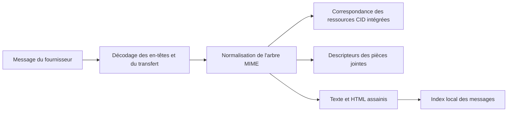

# Courrier

## Responsabilité

Le courrier intègre les comptes IMAP/SMTP, l'indexation locale des messages, les dossiers, la recherche, les étiquettes, les vues enregistrées, les brouillons, les pièces jointes, les réponses, la recherche de contacts, la rédaction assistée par IA et l'extraction d'entités. Les identifiants des fournisseurs restent locaux à chaque machine.

Le domaine strictement typé `frontend/src/features/mail/` gère la composition
de la page de courrier, les composants, les hooks d'étiquettes et de vues
enregistrées, ainsi que leurs tests. Les routes utilisent son entrée publique
à chargement différé sans charger immédiatement la boîte ou le compositeur.
Les adaptateurs HTTP partagés conservent les contrats API existants. L'éditeur
de courrier BlockNote et son adaptateur appartiennent à ce domaine. Les paramètres
utilisent l'éditeur via son entrée publique explicitement révisée ; il n'y a
ni copies d'implémentation ni façades de compatibilité. Le déplacement ne change ni
l'envoi, ni les brouillons, ni l'identité des dossiers, ni la confidentialité,
ni les opérations des fournisseurs.

## Visibilité des comptes

La barre latérale du courrier propose un interrupteur de visibilité par compte configuré. Les adresses des comptes masqués sont normalisées et enregistrées localement dans `mail.hiddenAccounts`. La visibilité est combinée au sélecteur de comptes avant de charger les messages et les compteurs de dossiers ; dossiers, vues enregistrées, catégories, étiquettes et recherche partagent ainsi le même périmètre. Masquer tous les comptes produit une boîte vide ; changer la visibilité ferme le message sélectionné. Cette préférence d’affichage ne désactive pas la synchronisation et ne supprime pas les identités d’envoi.

## Synchronisation

Les intégrations de comptes décrivent le protocole et les références OAuth ou d'identifiants secrets. Une synchronisation complète ou incrémentale lit les messages du fournisseur, normalise les identifiants et le contenu MIME, puis écrit les lignes de l'index local. Les workers IMAP IDLE maintiennent une connexion par compte admissible et déclenchent une actualisation incrémentale lorsque le serveur annonce des changements.

Les adaptateurs Google et Microsoft exposent les mêmes frontières typées pour
les messages, pièces jointes, brouillons, libellés et envois. Les payloads
dynamiques des SDK sont validés dans chaque adaptateur ; les seules exceptions
locales concernent les appels précis de découverte des bibliothèques tierces
non typées, jamais l'API de service consommée par Gnosi.
Le rafraîchissement OAuth n'accepte qu'un jeton concret non vide avant de le
persister. Le constructeur d'identifiants et l'appel de rafraîchissement Google
non typés sont isolés et documentés dans cet adaptateur ; IMAP et SMTP reçoivent
les types de connexion de la bibliothèque standard à la frontière XOAUTH2.

L'ingestion par lots utilise des points de sauvegarde transactionnels pour qu'un
message malformé n'annule pas les précédents. L'identité des messages et des fils
doit rester stable lors des synchronisations répétées. Les métadonnées d'interface
de chaque fil sont persistées dans un objet JSON validé sous la frontière locale
des secrets et données. Les lectures-modifications-écritures partagent un verrou
afin que des onglets concurrents ne perdent pas leurs champs respectifs. Les
racines ou entrées de fils malformées sont refusées sans affecter les données
valides. Les noms de dossiers sont des valeurs du fournisseur ; l'interface
traduit les dossiers sémantiques connus sans modifier les valeurs persistées
utilisées pour les comparaisons.

L'exporteur historique de Gmail vers le vault précise les types des payloads
de découverte à sa frontière de service, exige un répertoire Mail configuré
avant tout accès aux fichiers et déduplique par identifiant de message du
fournisseur. Le texte multipart, le HTML, les catégories, les libellés et la
présence de pièces jointes conservent leur représentation Markdown/frontmatter
historique. Un vault absent provoque un refus sans création de fichiers ailleurs.
Chaque note synchronisée conserve `database_table_id: mail`, et le frontmatter
est sérialisé par `yaml.dump` plutôt que par un échappement manuel de chaînes.

## Lecture des conversations et aperçu des messages

Les conversations Gmail utilisent la boîte `\All` du fournisseur, découverte
à partir des indicateurs IMAP même lorsque son nom est traduit. Les métadonnées
d'en-tête précédant et suivant le littéral du corps IMAP sont conservées,
y compris l'identité du fil, les dates et les libellés d'envoi. Les lectures
conservent le compte et le dossier car les UID IMAP sont propres à une boîte.
Le lecteur résout le fil depuis le message chargé, puis développe et charge
son élément le plus récent, y compris les réponses envoyées.

Les lectures des membres d'une conversation utilisent la même validation
complète et bornée des en-têtes que les boîtes agrégées. Les échecs de connexion
ou de commande, ou les membres manquants lors de la récupération, produisent
une erreur permettant une nouvelle tentative, plutôt qu'un fil vide ou partiel
présenté comme réussi.

Les lectures du corps des messages disposent d'une connexion IMAP réutilisable
séparée des listes de boîtes et des téléchargements de pièces jointes. La
réutilisation est liée au vault et à la configuration du compte ; l'invalidation
des identifiants ferme les deux voies et rejette une connexion obsolète qui
termine son authentification après l'invalidation. Une erreur de transport
invalide uniquement sa propre voie. Les lectures du fournisseur se terminent
par une réponse HTTP 503 permettant une nouvelle tentative après 25 secondes,
et les mutations de l'état de lecture s'exécutent dans des threads de travail.
Une mise à jour bloquée de la marque de lecture ne doit pas bloquer la boucle
d'événements du serveur ni le message sélectionné suivant.
Les requêtes du lecteur dépendent de l'identité du message dans son périmètre,
plutôt que du remplacement d'objets ou de callbacks. Le lecteur conserve au
maximum seize corps et une taille estimée de 4 MiB pendant cinq minutes après
leur récupération ; changer le contexte de la requête vide ce cache mémoire.
L’identifiant de message Internet disponible distingue les versions de sélection
et de cache ; lorsqu’il change, le contenu est rechargé même si l’UID reste identique.
Il s'agit d'un cache de session, pas d'une boîte hors ligne durable.
Les identifiants RFC enregistrés des messages vont directement au stockage
local du compte ; seuls les UID IMAP décimaux empruntent la voie distante du
corps.

Un corps déjà chargé peut servir sa copie IMAP dans un autre dossier lorsque le
compte et l'Internet Message-ID d'origine correspondent. L'UID et le dossier du
contenu d'origine restent associés aux images CID et aux pièces jointes ;
l'identité des actions n'est pas fusionnée. Les lectures de corps et de
conversations en échec proposent des reprises explicites traduites. Les
requêtes tardives ou annulées ne peuvent pas remplacer une nouvelle sélection.
Les réponses qui contredisent un compte, une boîte, un fournisseur ou un UID
indiqués sont rejetées, y compris avec des en-têtes partiellement identifiés.
Un corps rejeté termine le chargement et attend une nouvelle tentative explicite.

Les instantanés de listes et de compteurs et la réutilisation des images intégrées
sont également liés au vault actif. L’identité des images conserve le nom exact
de la boîte.

## Archive, listes complètes et recherche

Archive dispose de sa propre entrée de navigation. Tous les messages résout la
boîte `\All` traduite du serveur au lieu d'INBOX. Les serveurs sans boîte native
regroupant tous les messages fusionnent des instantanés d'en-têtes de chaque
boîte sélectionnable hors corbeille et courrier indésirable. Archive inclut
toutes les boîtes d'archive découvertes et leurs sous-dossiers. Les listes
natives et agrégées de Tous les messages/Archive trient tous les en-têtes
correspondants par date avant la pagination, y compris les messages importés
dont l'ordre des UID diffère de la date.
Les transferts d'en-têtes utilisent des lots d'au plus 200 UID ; les lots
sérialisés en cache sont limités à 256 KiB (au plus 32 MiB de données d'en-têtes
dans le cache partagé de 128 entrées).
La réutilisation exige une correspondance de l'appartenance à la boîte, du
périmètre et d'UIDVALIDITY. L'absence d'UIDVALIDITY désactive le cache facultatif,
conformément au modèle d'identité des boîtes du
[RFC 9051](https://www.rfc-editor.org/rfc/rfc9051.html#section-2.3.1.1).
Les lectures agrégées à froid peuvent nécessiter de nombreux allers-retours
d'en-têtes ; la voie du corps reste indépendante. Les noms de dossier et les UID
restent présents sur chaque ligne, y compris les UID réutilisés dans des
dossiers différents. Une lecture de boîte en échec ne peut pas publier un
résultat complet ou vide trompeur.

La découverte conserve les boîtes personnalisées et les multiples dossiers
d'archive, tout en ignorant les conteneurs non sélectionnables. Synchroniser
une archive conserve le type de message reçu et enregistre `archived: true` ;
cela ne classe pas le message comme supprimé. L'archivage Gmail retire le
libellé Boîte de réception et conserve les autres libellés. Les échecs
d'archivage distant restent des échecs, sans annoncer une opération réussie.

Les déplacements d’un seul message IMAP utilisent `MOVE` natif ou, après une
copie et une mise à jour des indicateurs confirmées, le nettoyage par
`UID EXPUNGE` (`UIDPLUS` ou `IMAP4rev2`). Les commandes en échec restent des
échecs. Les serveurs sans aucune de ces opérations sûres sont refusés avant
la copie ; déplacer un message ne supprime jamais les autres messages marqués
pour suppression. Voir [RFC 9051](https://www.rfc-editor.org/rfc/rfc9051.html#section-6.4.9)
pour la sémantique du nettoyage limité aux UID.

Les sous-dossiers d’archive utilisent le séparateur hiérarchique déclaré par
`LIST`, y compris ceux des conteneurs d’archive non sélectionnables. Les espaces
de noms `NIL` restent plats, comme le définit
[RFC 9051](https://www.rfc-editor.org/rfc/rfc9051.html#section-7.3.1).
Les sous-dossiers ordinaires héritent du contexte d’archive même lorsqu’ils se
nomment `Sent`, `Drafts` ou `All Mail`. Les attributs d’usage spécial déclarés par
le serveur restent prioritaires ; seul `\All` désigne une boîte native Tous les messages.

Les actions d’archivage et de mise à la corbeille, individuelles ou sur une
sélection, transmettent la boîte physique de chaque ligne. Un déplacement refusé
vers la corbeille renvoie une erreur permettant de réessayer ; les métadonnées
enregistrées ne changent qu’après réussite et conservent l’UID de destination.
Une action individuelle en échec conserve sa ligne et n’entre pas dans
l’historique d’annulation.

La sentinelle de pagination appartient à la liste qui défile réellement et
est de nouveau observée après la fin d'une page. Un fournisseur dont le curseur
ne progresse pas exige une nouvelle tentative explicite. Les comptes
indisponibles sont exclus de la pagination automatique ; les comptes sains
peuvent continuer leur chargement. Les nouvelles tentatives explicites ciblent
les comptes en échec à leurs curseurs d'échec et conservent les pages déjà
chargées des autres comptes.
La recherche est envoyée au fournisseur après un délai de 250 ms regroupant
les changements ; elle peut ainsi renvoyer des correspondances hors des pages
chargées et dans les corps. Le texte recherché fait partie du périmètre du
cache des listes, et les requêtes obsolètes sont annulées. Les critères des vues
enregistrées continuent de filtrer les lignes chargées ; ce ne sont ni des
règles de courrier entrant ni un moteur complet de requêtes côté serveur.

La [référence Apple Mail](../mail-apple-reference.md) consigne l'inventaire de
l'interface distribuée, la couverture actuelle de Gnosi et le travail restant
pour atteindre la parité.

Les envois réussis invalident les listes et les compteurs en cache ; la page
actualise les deux après la fermeture du compositeur. L'aperçu différé au
survol charge tout le texte ou HTML assaini sans marquer le message comme lu.
Il reste dans la fenêtre et ouvert tant que le pointeur le survole, et permet
le défilement vertical, les touches de navigation et Échap. Le chargement
commence uniquement au survol, avec annulation et nouvelle tentative. Les
cadres HTML calculent leur hauteur à partir du corps et non de leur propre
zone visible, ce qui évite une croissance répétée de la hauteur.

## Lecture au clavier

Les flèches haut et bas parcourent les groupes de messages dans l'ordre affiché,
même lorsqu'un message est ouvert. La ligne ciblée s'ouvre après 500 ms sans
nouveau déplacement ; les lignes intermédiaires ne sont ni ouvertes ni marquées
comme lues. Un clic ou la touche Entrée ouvre immédiatement le message. Le
lecteur existant marque le courrier non lu après son chargement réussi, en
conservant l'identité du compte et du dossier. Les messages lus restent visibles
dans la liste par défaut ; les filtres explicites des non lus et les vues
enregistrées conservent le comportement demandé.

Le focus suit l'identité du message plutôt qu'un indice de ligne variable. Les
mises à jour de lecture en arrière-plan ne redirigent pas la navigation en attente
vers le message précédemment ouvert. Changer de compte, dossier, vue, étiquettes
ou recherche annule l'ouverture en attente, tout comme rédiger, ouvrir un menu,
cibler un champ, quitter la fenêtre ou supprimer le message cible. La sélection
et la suppression par lot au clavier restent disponibles. L'aperçu distinct au
survol conserve ses propres touches de défilement et ne marque pas les messages
comme lus.

## MIME et sécurité du contenu

Le HTML est assaini avant rendu. Les images CID intégrées sont résolues vers la bonne partie MIME et préservées lorsque du contenu cité est inclus dans les réponses. Les images distantes et pièces jointes restent des ressources explicites, sans donner au HTML un accès arbitraire aux chemins locaux.

La frontière des images inline utilise des descripteurs MIME typés et une racine
`Message` commune aux arbres texte, related et mixed. Elle n'accepte que les
payloads décodés en octets, normalise les types de contenu optionnels et conserve
les URL des assets sans Vault actif ou fichier matérialisé.
Les mêmes contrats `MimeAsset` et `InlineImage` circulent sans changement dans
les expéditeurs Gmail, Microsoft Graph et SMTP. Les ressources citées deviennent
des images intégrées en renseignant explicitement tous les champs requis et
en générant un nouveau Content-ID.

## Composer et envoyer

L'éditeur de blocs crée un brouillon converti en HTML et texte adaptés au courrier. L'identité de l'expéditeur, les destinataires, les en-têtes de réponse, les citations, les pièces jointes et le compte du fournisseur sont validés côté serveur. Enregistrer un brouillon et envoyer sont des effets distincts ; l'envoi franchit une frontière externe et renvoie les diagnostics du fournisseur en cas d'échec.

## État relationnel local

La base de courrier stocke les messages, étiquettes, associations entre messages
et étiquettes, et vues enregistrées. Les vues contiennent les champs visibles,
filtres typés, logique, regroupements, tris et actions disponibles sous forme
JSON dans les lignes SQLite. Les schémas de création et de mise à jour partielle
restent des contrats Pydantic distincts : une mise à jour peut omettre le nom
sans affaiblir cette exigence à la création. Leurs structures HTTP et OpenAPI
restent compatibles avec les clients 2.x.

## Invariants

- La synchronisation est idempotente pour un identifiant de message du fournisseur.
- Les synchronisations IMAP en arrière-plan conservent les copies locales Markdown
  et HTML lorsqu'un UID est absent de la recherche du serveur, y compris les
  résultats vides et les changements d'espace d'UID. Les déplacements distants,
  la rétention ou les résultats absents n'autorisent pas la suppression de
  l'archive locale ; seules les actions explicites de messagerie de l'utilisateur
  en sont responsables.
- Un message en échec utilise un point de sauvegarde transactionnel et n'interrompt pas le lot du compte.
- Les étiquettes et vues enregistrées sont un état applicatif local, pas des libellés du fournisseur sauf correspondance explicite.
- Les en-têtes de réponse préservent l'identité du fil.
- Les références CID désignent la bonne partie intégrée après citation ou transfert.
- Supprimer ou déplacer un message chez le fournisseur exige le compte authentifié et une cible de dossier ou de message validée.
- Les secrets ne figurent jamais dans les lignes de messages ou les réponses de configuration du frontend.

## Aspects de vérification

Testez le décodage MIME, l'assainissement HTML, le rendu et les réponses CID,
les points de sauvegarde de l'ingestion, les étiquettes, les filtres des vues,
les brouillons, la résolution d'identité et un envoi via un fournisseur réel
ou simulé. Playwright vérifie le collage, la composition et les réponses citées.
