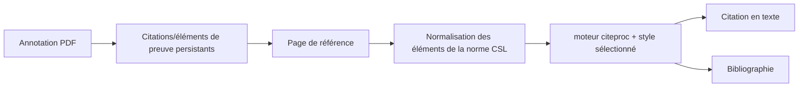

# Lecteur, références et citations

Les domaines frontend strictement typés `features/reader/` et
`features/literature/` gèrent leurs pages, composants locaux, états et tests.
Chacun expose une entrée publique différée, afin de charger indépendamment
la lecture des flux et la recherche bibliographique. Les styles de Literature
conservent leur ordre de cascade dans la fonctionnalité. Les adaptateurs de
requêtes partagés, l'intégration Zotero, la configuration des fournisseurs et
le rendu des citations ne sont pas dupliqués dans ces domaines.

Les routes, le stockage, l'analyse et les sources du Reader résident désormais
dans `backend/domains/reader/`; les dépôts, la recherche, la synchronisation et
le stockage bibliographique dans `backend/domains/literature/`. Les anciens
modules API et de services restent des façades de compatibilité aux contrats
publics inchangés.

L'analyse Reader dépendant du vault, l'accès aux résultats, la reprise,
l'annulation, le complément des articles et la génération de podcasts passent
par un contrôle unique du vault actif. L'absence de contexte renvoie une réponse
récupérable de service indisponible avant toute création de tâche ou de thread ;
les chemins valides et les payloads des routes restent stables. La génération
de podcasts utilise directement le générateur canonique typé des sessions de
base de données et le ferme dans le bloc `finally` existant, sans cast ni
fabrique de sessions dupliquée entre orchestration et persistance.

Les routes HTTP, les modèles canoniques et les services de revue systématique
sont strictement typés. Le comptage PRISMA, les transitions de sélection, les
preuves d'accès ouvert et les exports CSV/JSON/Markdown/SVG résident dans le
domaine pur `review_logic.py` ; les fonctions historiques restent des façades.

## Couvertures automatiques et modèles de ressources

La création depuis une source charge les modèles de la table avant de comparer
le type Zotero détecté, y compris ses libellés traduits. Le modèle correspondant
fournit le contenu et les valeurs initiales ; les métadonnées importées ont
priorité, mais une couverture existante du modèle est conservée. Sans
correspondance, le modèle par défaut est utilisé. Les nouveaux enregistrements
n'héritent pas des indicateurs de modèle.

La recherche ISBN conserve la couverture de l'édition fournie par Open Library.
Les recherches DOI et web utilisent l'image déclarée par l'éditeur via la
consultation existante des URL publiques. La couverture reste facultative et
ne conditionne pas les métadonnées. Si le PDF importé n'a aucune couverture
proposée ou issue du modèle, le navigateur produit un JPEG borné de sa première
page et l'enregistre dans Assets/Covers avant de créer la ressource. Le PDF
original reste joint. Un échec de génération ou d'envoi de la couverture ne
bloque pas la création. Les couvertures en ligne restent des URL externes ;
celles issues du PDF sont locales. L'enrichissement affiche un aperçu sans
présélectionner le remplacement d'une couverture existante.

Une seule notification de progression reste visible après la fermeture du
dialogue de recherche. Elle indique la préparation, le téléversement du PDF,
la création de la couverture, l’enregistrement et l’ouverture au début de chaque
étape. Elle confirme la réussite après l’ouverture de la fiche, ou affiche une
erreur si la création échoue. Les imports par identifiant affichent uniquement
les étapes applicables.

## Métadonnées bibliographiques complètes

Les champs `Autoría`, `Editors`, `Traductors` et les autres rôles CSL des Ressources utilisent l’éditeur de type `autoria`. La configuration `citation_role` et les métadonnées internes `_citation_roles` maintiennent les rôles distincts lorsque les champs sont renommés. L’extension du schéma est additive et idempotente.

Le schéma Zotero figé génère `reference_catalog.py` et `referenceCatalog.ts` avec `pipeline/skills/zotero_schema/scripts/build_reference_catalog.py`. Les deux convertisseurs CSL partagent le catalogue des champs et des dates, conservent l’année, le mois et le jour et utilisent les anciennes valeurs de `Zotero Extras`. L’import académique conserve les métadonnées complémentaires pendant la déduplication et l’import.

BibTeX et RIS exposent les champs et rôles compatibles. Le champ `gnosimetadata` et la balise `GN` contiennent une extension exclusivement bibliographique pour les deux noms de famille, les collectivités, les types de ressources et les champs sans équivalent dans le format. Gnosi les restaure à la réimportation tout en respectant les modifications externes des champs standard. Les autres logiciels peuvent supprimer cette extension et ne garantissent pas la récupération de ces données. Les chemins locaux et les propriétés personnelles sans rapport avec la bibliographie sont exclus.

## Responsabilité

Ce domaine combine la lecture de flux et de newsletters avec un gestionnaire de références compatible Zotero, le rendu des citations CSL, l'import par identifiant ou depuis le web, la lecture PDF/EPUB et les annotations pouvant servir de preuves citables.

## Ingestion des références

Crossref, Open Library, arXiv, PubMed et les métadonnées HTML possèdent des
normalisateurs typés distincts dans
`backend/domains/vault/citations/normalizers/`. Ils préservent les payloads
Zotero canoniques et le comportement de fonction pure, tandis que
`backend/services/lookup_normalizers.py` reste la façade compatible.

Les références entrent par DOI, ISBN, arXiv, PMID, BibTeX, RIS, fichiers ou URL web. Les résolveurs d'identifiants et le translation-server de Zotero produisent des métadonnées propres aux fournisseurs. Les normalisateurs les convertissent vers le schéma de référence configuré, génèrent une clé de citation stable, dédupliquent les candidats et écrivent un enregistrement dans le vault.

`backend/services/references_io.py` est la frontière typée et déterministe de
BibTeX/RIS. Ses petits assistants d'analyse, de normalisation, de mappage des
champs et de sérialisation préservent l'ordre, l'échappement, la résolution du
type et le contrat public d'import/export, sans persistance ni réseau cachés.
Le déduplicateur pur d'import utilise des structures explicites de métadonnées
et d'index d'identifiants ; sa priorité reste clé de citation, DOI, ISBN puis
titre normalisé. Un élément créé plus tôt dans le même import est ajouté de
manière idempotente aux mêmes index. Les entrées du catalogue CSL et le mapper
déclaratif de Zotero vers Recursos exposent des contrats sérialisables explicites,
tout en conservant les champs supplémentaires arbitraires des fournisseurs à
la frontière JSON externe. Les surlignages de citations gérés par Brain utilisent
les mappings typés SQLAlchemy ; l'unique exception non typée est isolée dans
l'adaptateur facultatif `pypdfium2`, qui ne publie pas de marqueur `py.typed`.

L'orchestration de recherche, strictement en lecture seule, réside dans le domaine
des citations, conserve la priorité DOI → arXiv → PMID → ISBN → URL et fait passer
les URL utilisateur par le téléchargeur protégé contre les SSRF avant toute suggestion.
La table Ressources désignée provient d'une configuration canonique unique ; seuls
les anciens vaults jamais configurés peuvent adopter automatiquement la première
table dotée d'une Citation Key, sous le même verrou que les réglages.

Le serveur de traduction est un service auxiliaire facultatif. Le mode natif peut fonctionner sans lui ; les résolveurs propres aux identifiants et les références existantes continuent de fonctionner. Les échecs de traduction web renvoient des erreurs permettant d'agir, pas un enregistrement vide présenté comme réussi.

`citations/pdf_fallback.py` dérive une référence citable des métadonnées PDF
lorsque la résolution échoue. `citations/web_capture.py` sélectionne et mappe les
résultats Zotero, tandis que `platform/translation_server.py` gère le transport HTTP.

## Découverte académique fédérée

Le plugin intégré Resources gère la configuration des dépôts, tandis que
`/api/vault/reference-table` reste la source de vérité unique de la table
Resources cible. `/literature` exécute chaque connecteur sélectionné indépendamment
et diffuse des résultats partiels. Une erreur de quota ou de fournisseur est
associée à sa source sans supprimer les résultats des sources opérationnelles.
`backend/domains/literature/connectors/` possède le transport HTTPS borné,
l'audit des requêtes, la normalisation canonique, OAI-PMH et JSON personnalisé,
les graphes de citations et les adaptateurs par famille de fournisseurs.
`backend/services/academic_connectors.py` reste uniquement une façade de
compatibilité. Le port typé résout ses collaborateurs à chaque appel afin que
les tests et intégrations puissent remplacer le transport, la validation, les
parseurs et le dispatch sans dupliquer l'état mutable.

L’adaptateur Dimensions traite `dimensions_api_key` comme une clé API. Chaque
recherche envoie d’abord `{ "key": "..." }` à `https://app.dimensions.ai/api/auth`
par POST, valide le jeton reçu, puis envoie la requête DSL en UTF-8 à `/api/dsl/v2`
avec `Authorization: JWT <token>`. Le jeton est obtenu pour chaque recherche et
n’est pas conservé. Un abonnement avec accès à l’API activé reste nécessaire.

Le transport POST partagé conserve la validation HTTPS, les délais, les limites
de taille et les erreurs sûres d’identifiants et de quota. Il refuse les
redirections afin de ne pas transmettre la clé ou le jeton. L’audit enregistre la
méthode HTTP réelle sans corps de requête ni en-têtes d’autorisation. Les jetons
absents ou invalides et les erreurs de requête sont signalés comme des erreurs du
connecteur. `backend/tests/test_dimensions_connector.py` vérifie ce flux et ses
échecs avec des réponses HTTP simulées ; un test réel nécessite une clé API activée.

`AcademicWork` est le contrat canonique des connecteurs. Les unions déterministes
utilisent, dans l'ordre, le DOI normalisé, le PMID ou PMCID, l'identifiant arXiv
sans version, l'ISBN-13 puis le titre normalisé avec l'année et le nom du premier
auteur. Une similarité approximative de titre n'est qu'un avertissement. Les
travaux fusionnés conservent chaque occurrence de source, emplacement ouvert,
compteur de citations propre au fournisseur, provenance des champs et variante
contradictoire.

L'aperçu est en lecture seule. Ajouter le texte intégral en pièce jointe est
une action manuelle distincte, proposée uniquement pour un emplacement ouvert
vérifié. L'import convertit le travail fusionné via le mapper Resources partagé
compatible Zotero et répète la recherche d'identité sous verrou atomique.
Si un enregistrement Resources correspond déjà, l'API le renvoie au lieu de
créer un doublon.

L'adaptateur d'import précise les types des objets imbriqués des fournisseurs
— publication, identifiants, dates, emplacements en accès ouvert et champs Zotero
supplémentaires — via une frontière de mapping unique avant conversion. Les
payloads des créateurs restent volontairement hétérogènes uniquement à la
frontière Zotero ; les clés déterministes, l'injection des clés de citation,
l'appartenance aux carnets et la réutilisation des doublons restent inchangées.

## Revues de littérature

L'état des revues systématiques réside dans quatre tables du vault gérées de
manière idempotente : `Literature Reviews`, `Literature Activities`,
`Literature Candidates` et `Literature Decisions`, cette dernière ne recevant
que des ajouts. Les stratégies, requêtes exactes aux fournisseurs, erreurs
partielles, opérations IA, décisions de sélection et exports restent ainsi
auditables et synchronisés avec le vault principal.

La sélection par un seul évaluateur et celle en double aveugle partagent les
mêmes phases. En mode aveugle, la décision d'un évaluateur est masquée jusqu'à
la soumission des deux décisions ; les conflits exigent un consensus explicite.
L'IA peut proposer des requêtes modifiables, reclasser, présélectionner ou
synthétiser les métadonnées obtenues, mais ne peut exclure un candidat ni
prétendre disposer de preuves au-delà du titre, résumé ou texte intégral
effectivement fourni. Le repli par chevauchement de tokens et le reclassement
facultatif par embeddings locaux partagent une structure typée d'enregistrement
de classement, préservant le score et l'ordre du rang initial.

Les index OAI et états temporaires de recherche sont reconstructibles et résident
sous `LOCAL_DATA` ; protocoles, historiques, candidats, décisions et artefacts
d'audit restent dans le vault principal. Les identifiants des dépôts utilisent
le Keychain natif ou l'environnement de déploiement, jamais le vault ou l'état
des plugins. Les lignes OAI filtrées conservent la liste canonique typée du
connecteur sans cast a posteriori. L'OCR PDF et l'analyse EPUB facultatifs
limitent leurs exceptions de typage aux imports précis `pypdfium2` et `ebooklib`,
dont les paquets ne publient pas de `py.typed` ; les objets dynamiques ne sortent
pas de l'adaptateur de documents.

## Parcours de citation

Les valeurs CSL sont dérivées du frontmatter des références avec des correspondances explicites de champs. Les listes de noms, dates, types d'éléments, échappements BibTeX/LaTeX et métadonnées Zotero `extra` nécessitent une normalisation. Le schéma épinglé protège les types et champs compatibles contre les évolutions divergentes en amont.

`backend/domains/vault/citations/exporting.py` gère le nettoyage Markdown, le
sous-ensemble de citations, les marqueurs de bibliographie, l'exécution de
Pandoc et l'empaquetage du téléchargement. La route de compatibilité conserve
sa signature publique et injecte les ports de fichiers, CSL et processus.

## Lecteur et annotations

Le lecteur Zotero intégré affiche les PDF et EPUB. Gnosi gère le pont qui localise les fichiers, sert des plages d'octets sûres, reçoit les annotations et relie les preuves sélectionnées aux enregistrements du vault. Les annotations contiennent l'URI source, la page, le type, la géométrie, le texte, le commentaire, les étiquettes, une clé gérée stable et les horodatages.

Les endpoints de fichiers vérifient le confinement et gèrent l'hydratation cloud. Les identifiants persistants des annotations empêchent de dupliquer une citation générée à chaque réouverture du document.

Le traitement conserve toutes les citations dans les notes et sélectionne un
sous-ensemble à surligner dans le PDF. Une heuristique locale compare chaque
citation complète au titre et au corps de sa note et privilégie les preuves
principales. Le surlignage couvre au maximum 15% du texte d'une page, avec au
plus deux citations sans chevauchement issues de passages distincts. Ce sont
des plafonds, sans quota obligatoire ; les citations longues ou peu adaptées
restent dans les notes sans surlignage. La géométrie de toutes les citations
est validée indépendamment de cette sélection visuelle. Une nouvelle
synchronisation retire uniquement les anciens surlignages gérés par la
ressource, en conservant les annotations manuelles et celles des autres
ressources.

Les propriétés de fichier ouvrent les pièces jointes PDF et EPUB dans le lecteur
interne avec l’action partagée d’ouverture. Les chemins relatifs au vault sont
convertis en URL de ressources servies ; les liens locaux et les URL externes de
documents utilisent la même route du lecteur. Si aucun tableau de bord ne traite
l’événement, la navigation ouvre la page du lecteur. Ouvrir une pièce jointe ne
modifie pas la valeur enregistrée. Les ressources du lecteur sont compilées avec
le script existant et restent hors du contrôle de version.

## Flux et newsletters

Les modèles de Reader stockent les sources, articles, états de lecture, contenus
intégraux extraits et un compte de newsletter. L'ingestion utilise des points de
sauvegarde transactionnels pour qu'une entrée malformée n'annule pas tout le lot.
Les extraits et l'extraction du texte intégral sont distincts ; une troncature à
l'ingestion ne doit pas supprimer définitivement un contenu source récupérable.

## Navigation du lecteur et enregistrement dans les Ressources

La liste conserve les articles lus et non lus. Les flèches haut et bas déplacent
le focus entre les articles et font défiler la liste pour afficher la ligne
sélectionnée. Quand le focus reste sur une ligne pendant 500 ms, le lecteur ouvre
l'article et le marque comme lu. Déplacer le focus, changer de source ou quitter
la liste annule l'ouverture en attente ; un clic ouvre immédiatement l'article.
Les changements d'état de lecture préservent l'article sélectionné et la
position dans la liste. Le corps est chargé à la demande, et une réponse tardive
concernant une sélection précédente ne peut pas remplacer le corps actuel.

L'action manuelle de marquage comme lu est remplacée par Ajouter aux Ressources
lorsque le module Ressources est activé. L'action attend le corps complet de
l'article et vérifie `/api/vault/reference-table` ; une destination non configurée
produit une erreur indiquant comment y remédier sans créer d'enregistrement.
L'enregistrement appelle `/api/vault/literature/imports` avec le titre, la date
de publication, le nom de la source, l'URL originale et le texte du corps.
L'importateur existant résout la table désignée et gère la persistance ; le
lecteur n'introduit ni second paramètre de table ni chemin séparé d'écriture.

Les actualités utilisent `newspaper-article`, converti en `newspaperArticle` de
Zotero. En l'absence d'identifiant bibliographique plus fort, la déduplication
utilise l'URL HTTP(S) originale sans son fragment avant de considérer le titre,
l'année et l'auteur. La clé enregistrée permet de réutiliser la ressource lors
d'importations répétées, même si l'article porte un autre identifiant local dans
le lecteur. Le bouton empêche les enregistrements simultanés, signale la réussite
et permet de réessayer après un échec.

## Invariants

- Les clés de citation restent stables à moins que l'utilisateur ne modifie explicitement les données d'identité.
- L'importation est dédoublée par des identifiants faisant autorité et des métadonnées normalisées.
- L'échec d'une source fédérée ne peut invalider les résultats déjà renvoyés par les autres.
- La similarité approximative ne fusionne jamais automatiquement des travaux académiques.
- Les métriques de citations restent séparées par fournisseur et ne sont jamais additionnées.
- Les suggestions IA ne deviennent jamais des décisions finales de sélection sans action humaine.
- Les chemins de fichiers lecteurs ne peuvent pas échapper aux racines autorisées.
- L'identité de document et la géométrie de page d'une annotation survivent à des redémarrages.
- Les composants internes du lecteur tiers intégré sont traités comme du code amont ; les modifications locales d'intégration sont explicites et reproductibles.
- Les mots de passe de la configuration de newsletters anciennes sont traités comme des secrets même
quand un ancien modèle expose encore un champ de compatibilité.

## Aspects de vérification

Exécutez les tests de clés de citation, PubMed, types d'éléments, styles CSL,
échappement BibTeX, entrées-sorties de références, annotations, confinement des
chemins, déduplication d'import et points de sauvegarde des flux. Ajoutez les
tests de normalisation des connecteurs, jetons et marqueurs de suppression OAI,
SSRF/XML, erreurs partielles, masquage entre évaluateurs, imports concurrents
et comptages PRISMA. Dans le navigateur, ouvrez un document de test réel et
vérifiez un aller-retour de citation ou d'annotation, puis une recherche
bibliographique progressive, sa provenance et l'import d'un résultat dédupliqué.

## Traitement des sources complètes et délais d’attente

Le traitement conserve la capacité de contexte du modèle choisi et transmet les
sources complètes lorsqu’elles y tiennent. La limite de contexte et le délai
d’exécution sont indépendants. Les requêtes dépassant 96 000 octets UTF-8 disposent
de 900 secondes par tentative et de 1 920 secondes au total ; les phases plus courtes
conservent 240 secondes par requête et 360 au total. Les limites de cinq tentatives et
de 120 secondes d’attente entre les tentatives restent applicables. Le seuil modifie
uniquement le délai, jamais le contenu ni le découpage.

Les dépassements de délai enregistrent un message utile, traduit dans la boîte de
dialogue et les notifications. La lecture dirigée copie les plans enregistrés vers la
nouvelle tâche avant de contacter le fournisseur, préservant la progression en cas
de nouvel échec. Les appels structurés respectent la même limite de contexte que les
autres lectures.

## Fichiers du lecteur PDF

Le lecteur PDF intégré nécessite tous les fichiers Zotero générés dans `frontend/public/zotero-reader`. Exécuter `bash scripts/runtime/build-zotero-reader.sh` avant de compiler une nouvelle copie. Vite vérifie les fichiers d’entrée et de sortie, notamment le moteur PDF, le worker, le visualiseur et la langue de secours. Le paquet de bureau utilise le même validateur. Les mises à jour de l’interface seule doivent aussi copier ce répertoire ; si le host manque, le délai expire avant l’ouverture du document. Le CI de l’interface et les releases préparent ces fichiers.

Lorsque l’adresse source de la preuve d’une citation est vide, le document joint à la ressource est utilisé. Les adresses locales des pièces jointes et les routes HTTP du vault actif partagent le même onglet du lecteur et la même identité des annotations. Le lecteur charge les surlignages existants depuis les deux formes d’URI, les déduplique selon leur identifiant en base de données et enregistre les nouvelles annotations sous l’URI canonique de la pièce jointe. Les annotations générées et manuelles restent disponibles sans retraiter la source ; les documents des autres vaults et les adresses externes conservent des identités distinctes.

## Attribution des champs aux notes générées

Chaque source sélectionne `assignment_field_ids` indépendamment de `index_field_ids`. Une liste absente conserve le comportement historique fondé sur les index ; une liste vide désactive les attributions. Les règles acceptent `ai`, `source`, `fixed` et `empty`. Seuls les champs modifiables peuvent être attribués. Les valeurs IA suivent des schémas typés et les valeurs catégorielles doivent appartenir aux options existantes. La copie et les valeurs fixes conservent zéro et faux ; les règles vides effacent la valeur lors du retraitement, tandis que supprimer une règle conserve les métadonnées existantes.

Le résolveur partagé `backend/domains/llm_wiki/options.py` consulte `config.catalog_ref` du vault actif avant les options locales : la configuration et le traitement utilisent ainsi les mêmes valeurs catégorielles. Un ancien `agent_id` vide sélectionne l’agent principal. L’éditeur attend que les règles de copie et de valeur fixe soient complètes avant de sauvegarder. Les tests de régression comprennent `backend/tests/test_llm_wiki_field_assignments.py` et `backend/tests/test_llm_wiki_processing_domain_contract.py`.

## Sections des sources et paratexte

Le traitement exclut des notes les couvertures, les métadonnées éditoriales,
les épigraphes initiales et les avant-propos, prologues ou préfaces, sauf demande
explicite. La couverture consigne ces passages, conservés comme contexte.

Le Brain conserve `Position` numérique et ajoute une relation unique `Section`
vers une table gérée de sections des sources. Les titres originaux conservent
leur hiérarchie, leur texte et des identités distinctes, même sans numérotation
ou avec des titres répétés. Chaque section appartient à une source et à un
document d'entrée ; les sélecteurs rejettent celles d'autres sources. Les filtres
d'égalité sélectionnent une section ; ceux d'inclusion ses descendants aussi.
Les pages et horodatages restent des repères de citation. L'audio et la vidéo
utilisent les chapitres natifs disponibles ; aucun chapitre n'est inventé.

La mise à jour du schéma conserve les notes et ne lance aucun traitement.
Le retraitement explicite attribue les sections et marque celles disparues comme
anciennes, tout en conservant les relations historiques. L'application dérive
les attributions des segments vérifiés, y compris lors d'une reprise révisée.

### Preuves PDF stables et recherche de citations

L’extraction PDF est conservée localement avec le SHA-256 de tous les octets du
fichier, la version de l’extracteur et une somme de contrôle du texte ordonné et
de ses localisateurs. L’estimation et le traitement partagent cette extraction :
répéter l’OCR ne rend pas invalide une lecture enregistrée si le PDF est inchangé.
Les demandes simultanées partagent une seule extraction. Des octets modifiés, des
entrées corrompues, un échec de l’OCR ou un fichier modifié pendant l’extraction
empêchent la réutilisation et l’enregistrement du cache. L’absence d’OCR sur les
pages contenant des images est une erreur explicite ; les pages blanches restent
acceptées. Les ressources natives sont fermées même en cas d’échec. Le cache
conserve les preuves sans certifier la précision de l’OCR.

La géométrie des citations indexe les caractères natifs une seule fois par page
et par synchronisation. Les index ne passent pas d’un fichier à un autre et ne
survivent pas à la synchronisation. Les contrôles de citation intégrale, de
lettres exactes et d’ambiguïté restent identiques ; seules les lectures répétées
des caractères sont éliminées.

Si PDFium renvoie un glyphe inconnu U+FFFE, un second décodeur PDF peut le
récupérer uniquement si toute la page normalisée a la même longueur et si tous
les autres caractères concordent. La valeur ne vient jamais de la citation
demandée ; toute autre différence empêche la récupération. Les indices de
la géométrie native d’origine sont conservés.

Les abonnements font autorité dans `<Vault>/.gnosi/reader_sources.json`
(version 1). SQLite local en est une projection identifiée par URL. Le premier
accès migre les sources existantes si le registre est absent ; les accès suivants
reconstruisent une base locale après déplacement du Vault ou changement du
répertoire de données. Les identifiants restent locaux et les liens des articles
existants sont conservés. Articles, état de lecture et identifiants du compte de
newsletters restent dans SQLite local ; déplacer le Vault ne les transfère pas.

Création et suppression de sources, import OPML et création d'expéditeurs de
newsletters enregistrent atomiquement le registre avant de valider SQLite. Un
verrou local sérialise les modifications et relit le registre. Une liste vide fait
autorité : une ancienne base ne peut ressusciter les sources supprimées. Des
métadonnées invalides, de version inconnue ou indisponibles dans le cloud
produisent une erreur réessayable sans écrasement. Les URL contenant un nom
d'utilisateur et un mot de passe doivent être nettoyées avant migration. Le
verrou local ne coordonne pas les écritures simultanées entre appareils ; les
conflits restent gérés par le fournisseur cloud.

Les adresses de newsletters acceptent aussi `newsletter://address@example.test`,
enregistré sous la forme `mailto:address@example.test`, y compris dans les imports
OPML ou du registre. Les doublons entre ces formes et les alias contenant des mots
de passe, séparateurs encodés, caractères de contrôle, chemins ou paramètres sont
refusés. Les liens des articles sont conservés. Les entrées RSS et mailto gardent
leur comportement ; cet alias ne configure aucun compte ni identifiant de messagerie.

### Couverture de la journée complète et articles sans contenu

Le podcast quotidien fige tous les articles publiés pendant les 24 heures
précédentes, y compris ceux déjà lus, et exclut les articles datés dans le futur.
Les nouvelles tentatives conservent la sélection, la période, la langue et le
nom du fichier de la tâche principale privée, même pour les anciens instantanés
sans ressources de comportement.

La génération normalise le corps complet, puis essaie le résumé du flux. Les
articles dépourvus des deux sont omis avant la synthèse. L'état expose
`skipped_articles` avec identifiants et titres ; le Lecteur affiche un avis
localisé. Si aucun article n'est lisible, `podcast_no_readable_articles` conserve
le MP3 précédent. Les avis concernent uniquement la tâche et ses entrées figées.

`podcast_briefing.py` découpe les originaux complets en parties et lots de huit
parties au maximum. Chaque partie contient au plus 10 000 tokens comptés et doit
produire une note non vide avec une citation exacte de l'original, un résumé de
400 caractères au plus et une citation de 160 caractères au plus. Les entrées
manquantes, supplémentaires ou mal citées échouent avant leur sauvegarde. Les
points de reprise privés et versionnés ne dépendent pas de la mémoire facultative
de conversation du modèle.

`podcast_outline.py` classe ensemble toutes les fiches et leurs résumés lorsque
la requête respecte la limite de 80 000 tokens et le contexte de l'application,
avec au plus 32 groupes éditoriaux. Les collections plus grandes utilisent une
hiérarchie bornée de 48 fiches et 40 000 tokens au maximum par requête, dans la
limite du contexte. Les champs obligatoires couvrent chaque identifiant opaque.
Le serveur développe les sources, valide des partitions exactes sans doublons
et conserve tous les sujets de chaque groupe.

Le rédacteur compose l'épisode complet avec toutes les notes et tous les groupes.
Pour plusieurs groupes, la réponse exige un paragraphe par clé opaque ; le
serveur les assemble dans l'ordre du plan sans lire les clés ni les métadonnées.
Un paragraphe vide exige une déclaration explicite d'absence de contenu éditorial,
vérifiée par les contrôles des sources et de l'ensemble. Les champs obligatoires
évitent la disparition silencieuse d'un groupe, sans prouver sa couverture
sémantique. Tous partagent un budget global, sans plafond individuel de mots.
Les journées riches en actualités visent 1 380 mots ; les petites collections
ont un objectif inférieur. Le texte complet doit respecter 90 à 109 % de
l'objectif global avant publication. Les comptes exacts du serveur et les
brouillons du modèle guident des réécritures automatiques bornées. Un texte de
longueur invalide n'est pas sauvegardé comme narration valide, tronqué ou remplacé
manuellement. Les preuves trop volumineuses utilisent des résumés internes
récursifs visant environ 160 mots, en conservant toutes les sources. Ce nombre
interne est indicatif : le contexte réel de chaque requête est vérifié et chaque
réduction doit diminuer la taille.
Les réponses des résumés internes ne contiennent que `topic` et `narration`.
Le serveur conserve tous les identifiants exacts du lot d'entrée à chaque niveau
de réduction, après avoir rejeté les identifiants invalides ou répétés.
Le modèle ne recopie pas cette liste, même lorsqu'un seul enregistrement récursif
représente des centaines de parties. Les nouveaux schémas et contrats séparent
les anciens points de reprise contenant des sections. Cette appartenance
structurelle ne valide pas la couverture thématique : les contrôles de fidélité,
de couverture et de l'épisode complet face aux originaux restent obligatoires.
La plage de mots du texte parlé reste stricte.
Chaque requête est vérifiée par rapport au contexte actuel, y compris les
corrections de longueur.

Les corrections de longueur utilisent un état numérique actuel distinct, qui
remplace les anciens comptes et ajustements tout en conservant les objections
sémantiques. Le serveur fournit le dernier script rejeté s'il tient après la
compression des sources. Sinon, la requête suivante demande une composition
nouvelle avec une cible absolue, sans appliquer d'ajustement à un texte absent.
Chaque nouvelle tentative de validation reçoit aussi le compte, le sens de la
modification et la cible du script qui vient d'être rejeté. Aucune narration
invalide n'est publiée ou tronquée et les limites d'appels et de contexte restent
inchangées.

Pour un brouillon structuré trop court, la réduction du contexte réserve la composition exacte la plus récente et les indications mesurées pour l’allonger. Elle continue de résumer les preuves jusqu’à ce que les deux tiennent ensemble, en conservant tous les sujets et les objections sémantiques. L’allongement n’utilise jamais le mode sans preuves réservé au raccourcissement. Si aucune réduction supplémentaire ne permet de respecter le contexte, la génération échoue explicitement au lieu d’abandonner le texte court et de recommencer. Des résumés internes ordinaires supplémentaires peuvent être nécessaires ; les tentatives de rédaction et les limites de temps, de contexte et de mots finaux restent inchangées.

`podcast_review.py` valide les citations exactes du texte et des preuves fournies
avant de sauvegarder les objections sémantiques. Les omissions identifient les
preuves ; les déformations factuelles exigent une affirmation citée et une preuve
qui la contredit directement. L'absence dans un lot ne réfute pas une information
étayée dans un autre. Les notes de production et répétitions citent le texte réel.
Un autre passage du modèle confronte les objections et ne peut conserver que les
objets démontrés, sans les modifier. Les confirmations sont réparties en lots
sans retirer leurs sources. Les omissions réelles non résolues bloquent la
publication.

Toutes les notes complètes sont comparées à la narration entière en lots bornés.
La révision de l'épisode vérifie également les sujets minoritaires et répétitions.
Jusqu'à trois cycles complets de rédaction et révision corrigent les objections
automatiquement. Seule la prose destinée à l'auditeur atteint la synthèse vocale ;
les étiquettes, preuves, avis d'accès aux sources et instructions de production
ne sont pas prononcés. Les échecs, refus et annulations conservent l'audio précédent.

Les vérifications des sources contrôlent séparément la fidélité factuelle et la
couverture thématique, avec au plus 16 notes par lot et la liste complète des
sujets. Le statut des faits, les attributions et la portée des chiffres font
l'objet d'un contrôle spécifique. Si le fournisseur épuise la sortie, seul le
lot de sources ou d'objections en échec est subdivisé récursivement ; la
confirmation conserve toutes les preuves originales. Un échec indivisible
bloque la publication. Chaque tour vérifie aussi l'épisode complet même si des
objections sur les sources subsistent. Les objections actuelles conservent leur
type et leurs sources ; les anciennes et les anciens scripts ne s'accumulent
pas dans les consignes de correction. Seul le dernier script est fourni comme
contexte facultatif séparé. Les limites de modèle, de sortie, de durée et
d'annulation sont conservées.

`podcast-coverage-report`, version 4, conserve le plan, toutes les notes, les
affectations du serveur et le nombre de mots. La couverture structurelle et les
citations exactes ne prouvent pas seules la justesse sémantique : la vérification
réelle doit comparer le texte à tous les thèmes et nuances et mesurer le MP3 par
rapport à l'objectif d'environ dix minutes.

Un épisode conforme au schéma mais hors de la plage globale de mots revient
immédiatement au coordinateur de longueur existant, avec trois tentatives. Il ne
consomme pas l’appel de réparation générique dans le même délai déjà partiellement
écoulé. Chaque phase existante conserve son délai de 300 secondes et ses deux appels de
format ; le coordinateur garde la composition rejetée exacte, les comptes mesurés et
tous les sujets. Le JSON mal formé conserve la réparation ordinaire bornée. Après la
dernière tentative, l’erreur publique de budget de mots reste inchangée.

Les opérations internes de planification, résumé, rédaction et révision disposent
de 300 secondes et 16 384 tokens de sortie, raisonnement inclus, sauf limite
explicite du profil. Les contrats actuels accompagnent les anciens instantanés ;
ces opérations n'utilisent pas de délégation facultative. Planification, rédaction
et résumé ne désactivent le raisonnement que si les métadonnées du fournisseur le
déclarent facultatif et si aucun choix explicite du profil ou client ne s'applique.
Les révisions conservent le raisonnement habituel. Le modèle, les protections,
préférences de sortie, délais, périmètre autorisé et publication atomique sont
préservés.

L'historique conserve les tâches principales autorisées avec les appels récents,
maintenant leur commande de reprise après plus de 50 appels internes. Les parents
absents ou hors périmètre ne sont jamais exposés. Les métadonnées exactes de
contexte prennent en charge les modèles absents du registre ; les limites
explicites priment et les modèles inconnus conservent la valeur prudente. Les
autres opérations documentaires gardent leurs protections.

Les objectifs indicatifs des paragraphes totalisent exactement le budget global. Les nouvelles tentatives de validation reçoivent les comptes actuels par paragraphe et une répartition proportionnelle suggérée, recalculée depuis la réponse immédiatement rejetée. Les mots peuvent être redistribués ; seuls la plage globale et les contrôles sémantiques déterminent l'acceptation.

### Consignes internes de correction bornées

Lorsque les objections confirmées dépassent à elles seules le budget de contexte
du rédacteur, les opérations de synthèse bornées produisent une consigne de
correction obligatoire pour chaque objection. Le rédacteur reçoit un transport
compact en colonnes avec tous les identifiants, types et périmètres de source
originaux ; les objections étayées complètes et leurs confirmations restent
dans les points de reprise existants. Cela n'approuve ni les objections ni la
narration. Les examens de fidélité, de couverture et de l'épisode entier face
aux sources originales conditionnent toujours la publication du texte réécrit.
Aucune limite de contexte, de mots, d'appels, de temps ou de passes sémantiques
n'est augmentée.

Les consignes internes utilisent un alphabet ASCII imprimable imposé par le
schéma, sans guillemets doubles, barres obliques inverses ni caractères de
contrôle. La limite dynamique de caractères correspond donc à la limite
d'octets UTF-8 après double sérialisation, au plus 160 octets ; le backend
vérifie aussi la taille encodée réelle. Les sorties invalides passent par la
réparation de validation bornée existante et ne parviennent pas au rédacteur
sans contrôle. Les sources originales, les objections confirmées complètes et
la narration finale en catalan conservent leur texte Unicode. Cette restriction
de transport ne modifie pas les sources incluses et n'approuve pas l'épisode
final : les examens sémantiques complets et le budget de mots restent requis
avant la synthèse vocale ou la publication.

Le schéma envoyé au fournisseur utilise une ancre de fin portable plutôt qu'une
assertion anticipée, que Xiaomi rejette comme requête invalide. Le backend exige
indépendamment des caractères ASCII imprimables et exclut les guillemets doubles,
les barres obliques inverses et les sauts de ligne, y compris le saut final accepté
par certains validateurs regex. Le schéma fermé, les identifiants exacts des
objections et la limite réelle d'octets restent contrôlés.

La réparation des consignes internes inspecte toutes les valeurs retournées au
lieu de se limiter au premier diagnostic du schéma. Le dernier appel existant
du modèle reçoit exactement tous les identifiants invalides, les objections
originales confirmées, les nombres réels de caractères et d'octets sérialisés,
et une cible indicative inférieure à la limite stricte existante. Le correctif
ne peut ajouter de clé ni réécrire une consigne valide. L'application restaure
la correspondance complète et répète les contrôles initiaux du schéma, de
l'alphabet et des octets avant de l'enregistrer. Si nécessaire, le brouillon
interne rejeté trop volumineux est omis ; les objections originales et les
comptages restent présents, dans la limite de contexte existante de 40 000 tokens.
Les appels autorisés, le délai partagé et les examens sémantiques finaux ne changent pas.

Une consigne rejetée contenant un Unicode invalide n'a pas de nombre valide
d'octets UTF-8. Son texte interne est exclu de la réparation et le comptage est
explicitement indisponible ; l'objection originale confirmée et le nombre de
caractères restent présents. Le remplacement doit toujours respecter les mêmes
contraintes d'ASCII imprimable et d'octets.

Le motif envoyé au fournisseur encode aussi la même limite dynamique en octets avec un quantificateur borné. Cela rend la limite explicite pour les services qui n’appliquent pas de manière fiable le champ séparé `maxLength`. La limite du schéma, les validations locales ASCII et octets et les revues sémantiques complètes restent inchangées.

Les corrections de longueur transportent le même flux complet et ordonné de mots dans une seule chaîne `token_text`, au lieu d’un élément JSON par mot. Le schéma du fournisseur vérifie la chaîne et toutes les exclusions sans motif global de comptage ; le serveur impose le même intervalle exact de mots prononcés avant la revue sémantique ou la voix. Les réponses hors intervalle passent par la correction automatique bornée existante, avec le compte mesuré et l’objet original reçu du modèle. Tous les marqueurs ordonnés, exclusions explicites et nuances sont vérifiés, et la lecture des anciens tableaux est conservée. Aucun texte n’est tronqué ou remplacé manuellement. Les contrôles de fidélité, de couverture et de l’épisode entier ainsi que les limites de contexte, d’appels et de temps restent inchangés. Les expirations réelles du transport avec comptage contraint motivent cette séparation ; seule une génération automatique réelle achevée peut établir le résultat.

## Préférences modifiables du podcast quotidien

La skill attribuée `core.gnosi-daily-briefing` contient les choix éditoriaux et un bloc JSON `podcast_preferences` dans ses instructions modifiables. Elle peut être personnalisée dans Configuration → IA. Par défaut, elle demande dix minutes et au plus douze groupes thématiques. Le bloc définit aussi le seuil d’articles, les mots par article et la longueur minimale des journées peu chargées. `podcast_policy.py` lit uniquement la skill canonique effective, y compris sa personnalisation attribuée ; les articles, les autres skills et le contexte du bot ne peuvent pas fournir ces paramètres. Les blocs partiels héritent des valeurs originales. Une configuration invalide, dupliquée ou ambiguë échoue avant tout appel au modèle. Chaque tâche fige les préférences résolues, les transmet à la planification, la rédaction et la révision, puis les consigne dans le rapport de couverture.

Le planificateur peut renvoyer moins de thèmes que le maximum configuré ; les journées riches ne sont plus complétées jusqu’à 32 positions. Chaque fiche conserve exactement une attribution à un thème déclaré et tous les identifiants et sujets originaux sont préservés. Le moteur conserve les limites techniques, les validations de schéma et de preuves, la révision des sources originales, la plage de mots, la persistance, l’annulation et les garanties de publication. Modifier la durée change la cible ; la valeur par défaut des journées riches reste 1 380 mots.

Le `review_mode` modifiable utilise `brief` par défaut : une revue globale des résumés des sources et des thèmes principaux, au plus une réécriture corrective, puis la publication normale de la voix. `full` active explicitement les audits exhaustifs des fragments originaux. Les métadonnées enregistrées identifient la portée réelle.

Dans le mode `brief` par défaut, au plus quatre lots indépendants sont préparés simultanément. Chaque lot conserve sa requête et sa clé de cache initiales, le contexte authentifié et la validation ; les résultats sont remis dans l’ordre des sources. Une annulation ou un échec empêche toute publication partielle. La reprise réutilise les mêmes points validés. Le raisonnement facultatif par défaut du fournisseur est désactivé pour l’extraction lorsque le modèle déclare le permettre ; les choix explicites du profil restent prioritaires. Le mode `full` explicite conserve une extraction séquentielle.

La synthèse brève utilise le budget de contexte résolu du modèle sélectionné, après les réserves existantes pour la réponse et les instructions. Le plan, la rédaction et la revue unique reçoivent directement toutes les notes des sources lorsqu’elles tiennent dans ce budget, sans imposer des résumés intermédiaires par un plafond distinct de 80 000 unités. Le comptage conservateur et la vérification finale du budget de chaque requête restent appliqués. Les petits contextes conservent la compression de secours ; le mode `full` explicite conserve son plafond de synthèse de 80 000 unités.

Les réécritures courtes en mode `brief` utilisent le contrat existant `word_tokens_v1` lorsque le maximum de mots et les marqueurs de groupes ne dépassent pas 2 048 éléments. Les corrections sémantiques l’utilisent directement ; un premier rejet de longueur y passe également. Les bornes de la liste imposent la plage globale et chaque élément contient un seul mot délimité par des espaces. Tous les marqueurs ordonnés et les exclusions explicites restent vérifiés ; aucun texte n’est coupé et aucun plafond rigide par groupe n’est imposé. Les limites d’appels, d’étapes et de durée restent inchangées. Le mode complet et les épisodes longs gardent le transport compact ; les réponses compactes enregistrées restent lisibles.

Lorsqu’un brouillon relu en mode `brief` respecte déjà la plage globale de mots et que toutes les preuves tiennent dans le contexte choisi, la correction sémantique utilise `grounded_edits_v1` au lieu de régénérer l’épisode. Le modèle renvoie des remplacements bornés, ancrés de façon unique dans le brouillon immuable exact, avec les indices des problèmes à partir de zéro et son SHA-256. Le serveur rejette les empreintes périmées, les ancrages ambigus ou superposés, les problèmes non référencés et un résultat hors de la plage de mots. Le texte non modifié est conservé à l’identique ; toutes les notes des sources, les groupes thématiques et les problèmes restent disponibles. L’étape conserve deux appels, 300 secondes et la limite de jetons de sortie. Aucune modification partielle n’est publiée et la synthèse vocale normale ne reprend qu’après validation. Les réécritures complètes et les premières corrections de longueur conservent les transports précédents.
