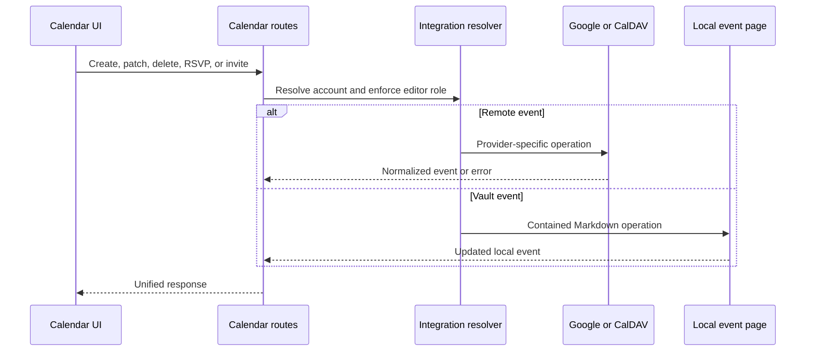

# Calendar and meetings

## Responsibility

Calendar aggregates local Vault events with connected Google Calendar and
CalDAV accounts. It supports calendar selection, event CRUD, invitations,
RSVPs, free/busy queries, geocoding, reminders, hidden-event state, ICS export,
meeting recording, transcription, and AI-generated notes.

The strictly typed `features/calendar/` frontend owns the calendar page,
source selection, search, recurrence coordination, and page dialogs. Its
public entry retains the original lazy-loading boundary. Calendar renderers
also consumed by Vault and Mail remain shared outside the route feature;
provider adapters, reminder watchers, and event payloads are unchanged.

`features/meetings/` owns the floating recorder, its capture/upload controller,
and reminder presentation. Its public entry defers recorder and reminder modules
independently. The shell mounts them through the same plugin gates as before;
relocation does not change recording permissions, polling, navigation, or payloads.

The HTTP boundary is strictly typed while preserving the existing response
contract. Photon label normalization, URL rejection, result validation, and
deduplication belong to the Calendar geocoding domain rather than the route
module; provider payloads remain validated at that adapter boundary.

The hybrid provider service is strictly typed and keeps Google as one adapter
beside generic CalDAV. CalDAV account detection therefore supports Nextcloud,
iCloud, Fastmail, Radicale and compatible servers through configured URLs,
without introducing storage-provider-specific workspace behavior.

The hybrid route queries external providers directly. Opening the calendar does
not start a second provider-to-Vault mirror, so page-index refreshes cannot
duplicate or delay Google and CalDAV reads. Existing Markdown below
`Calendar/External` remains user data and is never deleted by this transition,
but the web runtime no longer refreshes that legacy mirror.

## Event aggregation

The route layer resolves workspace context and selected integrations, then
normalizes provider events and local Markdown events into a shared response.
Provider identifiers remain paired with their account/calendar origin; an ID
alone is not globally unique enough for mutation.

Hidden events are local overlay records. Hiding does not delete a provider
event. Unhide removes the overlay so the next aggregation includes it again.

## Mutation flow

## Reminders and meeting notes

Reminder settings select lead time and behavior. Collection merges upcoming
events and deduplicates concurrent requests so duplicate reminders are not
created. The frontend watcher displays active reminders and can navigate to the
calendar or dismiss them.

Reminder persistence narrows its JSON state into explicit settings, notified
keys and active reminder objects. Time parsing accepts provider values at one
boundary, attendee labels are normalized to strings, and AI output is converted
before storage. The existing whole-cycle lock and fresh-state merge remain the
authority for scheduler/API races.

Meeting recording uploads bounded audio to a background workflow. Status polling
separates recording, transcription, summarization, note creation, completion,
and failure. Generated notes are written through Vault-safe operations and
retain event/source context. The background service normalizes the legacy Vault
route result to a concrete mapping before reading the created page identifier;
dynamic compatibility handlers do not leak into the typed job boundary. Record
and polling responses pass through dedicated Pydantic models while returning
the same directly indexable dictionaries used by existing callers.

## Invariants

- Provider event identity includes account and calendar context.
- Calendar writes require an editor-capable context.
- Path-based local events remain inside the active vault.
- Hiding is local and reversible; deletion uses the authoritative provider.
- Reminders are race-safe and do not duplicate for the same event/window.
- Missing transcription or AI providers fail the meeting job, not the calendar.
- ICS output uses normalized time zones and does not expose private credentials.

## Verification focus

Test local path containment, event normalization, recurrence, hidden state,
reminder races, account selection, time zones, and Playwright create/edit/delete
flows. Meeting QA should record or upload a fixture, observe background status,
and verify the resulting Vault page.

## Conditional CalDAV writes, conference links and booking

Private writes retain an explicit provider across creation, PATCH and DELETE. When accounts share an email, this hint selects the correct account; unsupported hints reject before provider I/O. DELETE accepts the optional `provider` query parameter, which existing clients may omit. Calendar names remain display labels, while write destinations use provider/account/calendar identifiers.

`domains/calendar/provider_operations.py` dispatches through the configured account provider. CalDAV resources use confined discovery and resource URLs, conditional PUT/DELETE and the previous ETag. The frontend carries the returned ETag into its next autosave. A stale resource returns a conflict instead of replacing another client's edits. Recurring CalDAV resources remain read-only for mutation. New timed events use UTC instants, so their payloads are self-contained without relying on the server's timezone-by-reference extension; updates retain existing date representations. `conference_links.py` normalizes provider video URLs into `join_url`; the event inspector opens only HTTP(S) links without credentials or a referrer.

Unchanged text retains its whitespace and all property parameters. Editing text retains language and extension parameters, but removes ALTREP because its alternate representation may describe the old value.

`domains/booking/` computes the union of busy intervals across selected calendars, including local events, and applies the configured time zone, working week, duration, buffers, notice and horizon. Provider failures close availability. The CalDAV query fallback preserves nominal days versus elapsed hours and blocks unsupported recurrence expansions, including nonexistent local times it cannot resolve safely. The booking destination must be among the calendars checked. External integration credentials are installation-wide, so external public scheduling is restricted to the personal workspace owner.

Local recurrence skips nonexistent wall times before applying COUNT; excluded real instances still consume the count. Timed instances retain elapsed duration, while all-day spans retain nominal days. Finite-count expansion validates from the first occurrence with a 3,000-instance evaluation limit; invalid intervals and unsupported expansion close availability.

The anonymous surface is exactly GET `/api/booking/public/{token}`, GET its `/slots` and POST its `/reservations`. Owner-only management lives at `/api/booking/links` and aggregate checks at `/api/booking/availability`. A durable SQLite claim serializes overlapping reservations across one owner's links and across different owners checking the same vault or external calendar before writing an event. Unrelated owners' calendars do not block one another. Idempotent replay never repeats an uncertain provider write; pending claims keep their slot blocked and are visible to the owner. Concurrent changes made directly in another calendar client cannot be made atomic with Gnosi's reservation transaction.

Read dispatch selects unresolved account metadata without unlocking credentials. Authentication remains inside the selected provider adapter, and the provider/account/calendar selection is retained when accounts share an email.
