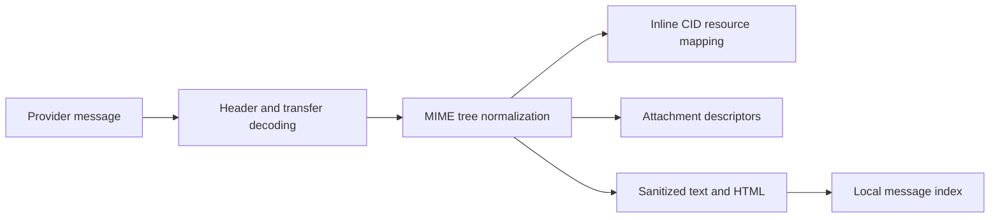

# Mail

## Responsibility

Mail integrates IMAP/SMTP accounts, local message indexing, folders, search,
tags, saved views, drafts, attachments, replies, contact lookup, AI drafting and
entity extraction. Provider credentials remain local per machine.

The strictly typed `frontend/src/features/mail/` domain owns mailbox page
composition, mail components, tags and saved-view hooks, and their tests.
Application routes consume its public lazy entry without eagerly loading the
mailbox or composer. Shared HTTP adapters keep the existing API contracts.
The BlockNote mail editor and its adapter belong to this domain. Settings
consumes the editor through its explicitly reviewed public entry; there are no
copied implementations or compatibility facades. Moving ownership does not change
sending, draft saving, folder identity, privacy, or provider operations.

## Account visibility

The mailbox sidebar has one visibility switch per configured account. Hidden account addresses are saved locally in `mail.hiddenAccounts` using normalized addresses. Visibility intersects the account selector before loading messages and folder counts, so folders, saved views, categories, tags and search share the same scope. Turning every account off produces an empty mailbox; changing visibility closes the selected message. This display preference does not disable synchronization or remove sending identities.

## Synchronization

Account integrations describe protocol and OAuth/credential references. A full
or incremental sync reads provider messages, normalizes identifiers and MIME
content, and writes local index rows. IMAP IDLE workers hold one connection per
eligible account and trigger incremental refresh when the server announces
changes.

Google and Microsoft provider adapters expose the same typed Gnosi message,
attachment, draft, label, and send boundaries. Dynamic SDK payloads are narrowed
inside each adapter; the only local typing exceptions are the exact untyped
third-party discovery calls, never the service API consumed by Gnosi.
OAuth refresh accepts only a concrete non-empty token before persisting it.
Google's untyped credential constructor and refresh call are isolated and
documented inside that adapter; IMAP and SMTP receive standard-library
connection types at the XOAUTH2 boundary.

Batch ingestion uses savepoints so a malformed message cannot roll back earlier
messages. Message and thread identity must remain stable across repeated syncs.
Per-thread UI metadata is persisted as a validated JSON object under the local
secrets/data boundary. Read-modify-write operations share one lock so concurrent
tabs cannot silently discard each other's fields; malformed root or thread
entries fail closed without affecting valid records.
Folder names are provider values; the UI translates known semantic folders
without changing persisted comparison values.

The legacy Gmail-to-Vault exporter narrows discovery payloads at its service
boundary, requires a configured Mail directory before any filesystem access,
and deduplicates by provider message id. Multipart text, HTML, categories,
labels and attachment presence retain their historical Markdown/frontmatter
representation; a missing Vault fails closed without creating files elsewhere.
Every synchronized note retains `database_table_id: mail`, and frontmatter is
serialized through `yaml.dump` rather than hand-built string escaping.

## Conversation reading and message previews

Gmail conversations use the provider's `\All` mailbox, discovered from IMAP
flags even when its name is localized. Header metadata before and after an IMAP
body literal is preserved, including thread identity, dates and sent labels.
Message reads retain both account and folder because IMAP UIDs are scoped to a
mailbox. The viewer resolves the thread from the loaded message and expands
and loads its newest item, including sent replies.
Conversation member reads use the same bounded, complete header validation as
aggregate mailboxes. Failed connections/commands or missing fetched members
produce a retryable error rather than an empty or partial successful thread.

Message body reads have a separate reusable IMAP connection from mailbox listings
and attachment downloads. Reuse is bound to the vault and account configuration;
credential invalidation closes both lanes and rejects an obsolete connection
that finishes authenticating after invalidation. A transport error invalidates
only its own lane. Provider reads end with a retryable HTTP 503 after
25 seconds, and read-state mutations run in worker threads. A stalled read flag
update must not block the server event loop or the next selected message.
Reader requests depend on scoped message identity rather than object/callback
replacement. The reader keeps at most sixteen bodies and an estimated 4 MiB for
five minutes after fetching; changing request context clears this memory cache.
An available Internet Message-ID versions both the selection and cached body;
changing it refetches content even when the UID stays unchanged.
This is a session cache, not a durable offline mailbox.
Saved RFC message IDs go directly to account-scoped local storage; only decimal
IMAP UIDs enter the remote body path.

An already loaded body can serve its IMAP copy in another folder when the account
and original Internet Message-ID match. The original content's UID and folder
remain attached to CID images and attachments; action identity is not merged.
Failed body and conversation reads expose explicit localized retries. Late or
cancelled requests cannot replace a new selection.
Responses that contradict a supplied account, mailbox, provider or UID are
rejected, including partially identified headers. A rejected body ends loading
and waits for an explicit retry.

Mail list and count snapshots and inline-image reuse are also bound to the active
vault. Inline-image identity preserves the exact mailbox name.

## Archive, complete listings and search

Archive has its own navigation entry. All Mail resolves the server's localized
`\All` mailbox instead of INBOX. Servers without a native All mailbox merge
header-only snapshots from every selectable non-trash/non-spam mailbox. Archive
includes all discovered archive mailboxes and their child folders. Both native
and aggregate All/Archive listings sort every matching header by date before
pagination, including imported messages whose UID order differs from their date.
Header transfers use batches of at most 200 UIDs; serialized cached batches have
a 256-KiB cap (at most 32 MiB of header payloads in the shared 128-entry cache).
Reuse requires matching mailbox membership, scope and UIDVALIDITY. Missing
UIDVALIDITY disables optional caching, following the mailbox identity model in
[RFC 9051](https://www.rfc-editor.org/rfc/rfc9051.html#section-2.3.1.1).
Cold aggregate reads can require many header round trips; the body lane remains
independent. Folder names and UIDs
remain present on each row, including reused UIDs in different folders. A failed
mailbox read cannot publish a misleading complete or empty result.

Discovery retains custom mailboxes and multiple archive folders, while skipping
non-selectable containers. Archive descendants use the hierarchy delimiter
declared by `LIST`, including descendants of non-selectable archive containers;
`NIL` namespaces remain flat, as defined by
[RFC 9051](https://www.rfc-editor.org/rfc/rfc9051.html#section-7.3.1).
Ordinary descendants inherit their archive context even when named `Sent`,
`Drafts` or `All Mail`. Explicit server special-use attributes retain priority;
only `\All` designates a native All mailbox.
Synchronizing an archive preserves a received-message
type and records `archived: true`; it does not classify the message as deleted.
Gmail archiving removes the Inbox label and preserves other labels. Remote
archive failures remain failures rather than reporting a successful operation.

Single-message IMAP moves use native `MOVE` or, after a confirmed copy and flag
update, cleanup through `UID EXPUNGE` (`UIDPLUS` or `IMAP4rev2`). Failed commands
remain failures. Servers without either safe operation are rejected before
copying; moving one message never expunges other messages marked for deletion.
See [RFC 9051](https://www.rfc-editor.org/rfc/rfc9051.html#section-6.4.9) for
UID-scoped cleanup semantics.

Archive and Trash actions on individual rows and selections pass each row's
physical mailbox. A rejected Trash move returns a retryable error; saved metadata
changes only after success and records the destination UID. A failed inline
action keeps its row and does not enter the undo history.

The pagination sentinel belongs to the actual scrolling list and is observed
again after a page completes. A provider that returns no cursor progress requires
an explicit retry. Unavailable accounts are excluded from automatic pagination;
healthy accounts can continue loading. Explicit retries target failed accounts
at their failed cursors and preserve the pages already loaded from other accounts.
Search is debounced for 250 ms and sent to the provider, so
matches outside loaded pages and matches inside bodies can be returned. Search
text is part of list-cache scope, and obsolete requests are cancelled. Saved-view
criteria continue to filter loaded rows; they are not incoming-mail rules or a
complete server-side query engine.

The [Apple Mail reference](../mail-apple-reference.md) records the shipped
interface inventory, current Gnosi coverage and remaining parity work.

Successful sends invalidate cached mail lists and counts; the page refreshes
both after the composer completes. The list's delayed hover preview loads the
complete plain-text or sanitized HTML body without marking it read. Its portal
stays inside the viewport, remains open while the pointer is over it, and
supports vertical scrolling, navigation keys and Escape. Loading is deferred
until hover, with cancellation and retry. HTML frames size from body content
rather than their own viewport, avoiding recurring height growth.

## Keyboard reading

Arrow Up and Arrow Down move through the displayed message groups, including
when a message viewer is open. A focused row opens after 500 ms without another
navigation step; intermediate rows are neither opened nor marked read. Clicking
or pressing Enter opens immediately. The existing viewer marks unread mail read
after the message loads successfully, preserving its account and folder identity.
Read messages remain visible in the default list; explicit unread filters and
saved-view filters retain their requested behavior.

Focus follows the message identity rather than a mutable row index. Background
read-state updates do not redirect pending navigation to the previously opened
message. Changing account, folder, view, tags or search cancels the pending
opening, as do composing, opening a menu, focusing an input, leaving the window
or removing the target message. Keyboard batch selection and deletion remain
available. The separate hover preview keeps its own scrolling keys and does not
mark messages read.

## MIME and content safety

HTML is sanitized before rendering. Inline CID images are resolved against the
correct MIME part and preserved when quoted content is included in replies.
Remote images and attachments remain explicit resources rather than arbitrary
HTML access to local paths.

The inline-image boundary uses typed MIME asset descriptors and a common
`Message` root for text, related and mixed trees. It accepts only decoded byte
payloads, normalizes optional content types, and leaves asset URLs unchanged
when no active Vault or materialized file is available.
The same `MimeAsset` and `InlineImage` contracts flow unchanged through Gmail,
Microsoft Graph and SMTP senders. Quoted assets are promoted to inline images
by explicitly filling every required field and generating a fresh Content-ID.

## Compose and send

The block editor creates a draft representation that is converted to mail-safe
HTML and text. Sender identity, recipients, reply headers, quoting, attachments,
and provider account are validated server-side. Draft save and send are
different effects; sending crosses an external boundary and returns provider
diagnostics on failure.

## Local relational state

The mail database stores messages, tags, message-tag associations, and saved
views. Saved views contain visible fields, typed filters, logic, grouping,
sorting, and available actions as JSON within SQLite rows.
Create and partial-update schemas remain separate Pydantic contracts so an
update may omit its name without weakening the create requirement; their HTTP
and OpenAPI shapes remain compatible with 2.x clients.

## Invariants

- Sync is idempotent for a provider message identifier.
- IMAP background pulls preserve local Markdown and HTML copies when a UID is
  absent from the server search, including empty results and UID namespace
  changes. Remote moves, retention or missing search results do not authorize
  deleting the local archive; explicit user mail actions own deletion.
- A failed message uses a savepoint and does not abort the account batch.
- Tags and saved views are local application state, not provider labels unless
  an explicit mapping exists.
- Reply headers preserve thread identity.
- CID references point to the correct inline part after quoting or forwarding.
- Deleting or moving a provider message requires the authenticated account and
  a validated folder/message target.
- Secret values never enter message rows or frontend configuration responses.

## Verification focus

Test MIME decoding, HTML sanitization, CID rendering and replies, ingestion
savepoints, tags, view filters, drafts, identity resolution, and a real or
stubbed provider send. Playwright verifies paste, compose, and quoted reply
behavior.
